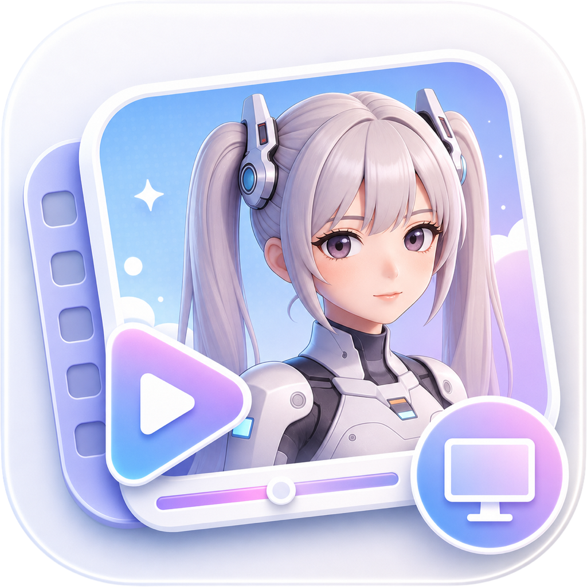
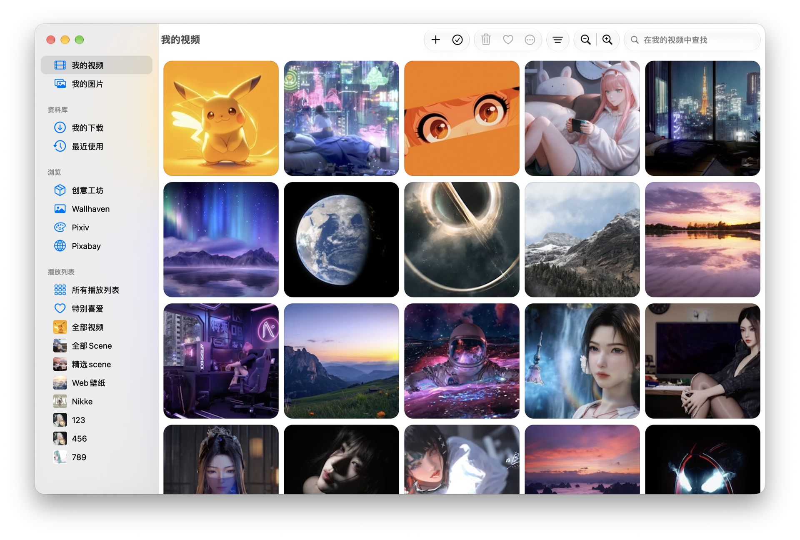
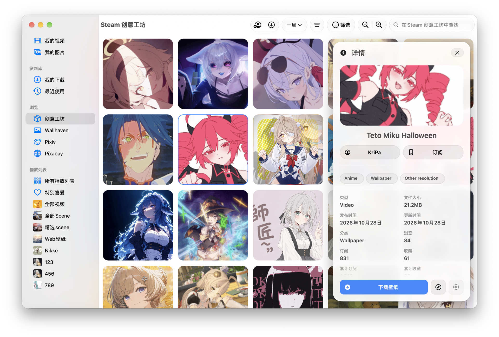
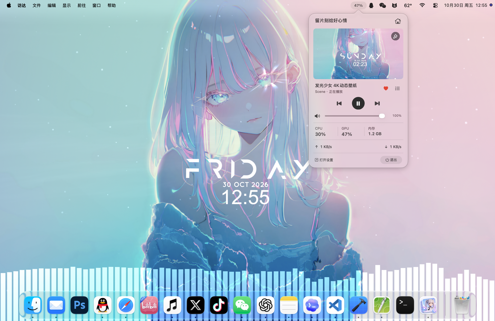
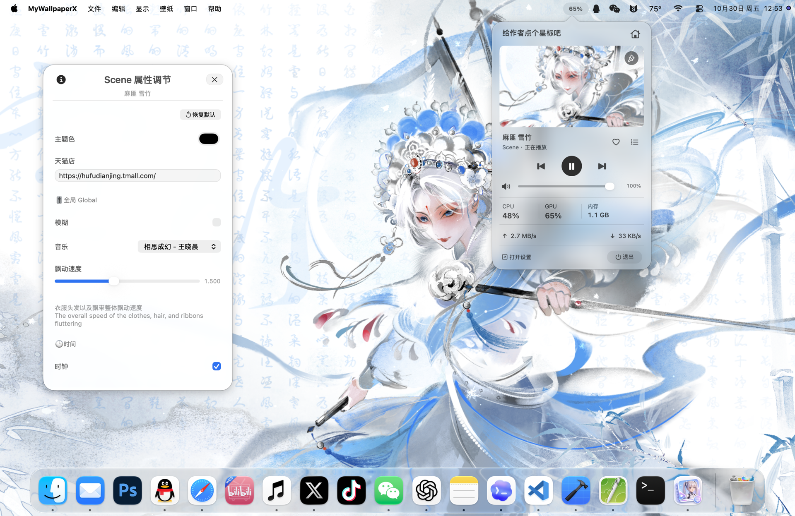

  

<h1 align="center">MyWallpaperX</h1>

<strong>Einfach aus Prinzip. Pur gestaltet.</strong>

Eine Engine für animierte Hintergrundbilder für macOS im Stil von Wallpaper Engine – nichts einzurichten, bevor das erste Hintergrundbild läuft. Nativ · Animiert · Open Source

  <a href="README.md">简体中文</a> ·
  <a href="README.en.md">English</a> ·
  <a href="README.ru.md">Русский</a> ·
  <a href="README.de.md">Deutsch</a> ·
  <a href="README.fr.md">Français</a>

  
  
  
  

  <a href="https://github.com/songziqiang9512/MyWallpaperX/releases/latest">Herunterladen</a> ·
  <a href="docs/releases/2.12.4.md">Neu in 2.12.4</a> ·
  <a href="https://www.mwpx.me">Website</a> ·
  <a href="https://github.com/songziqiang9512/MyWallpaperX/issues">Issues</a>

---

**MyWallpaperX** ist eine Open-Source-Engine für animierte Hintergrundbilder, entwickelt für Macs mit Apple Silicon. Sie folgt der Semantik der Werke von Wallpaper Engine unter macOS und spielt unterstützte Scene- und Web-Hintergrundbilder ab; außerdem importiert sie lokale Videos und Bilder, damit du eigene Wiedergabelisten anlegen, nach Zeitplan umschalten und dem Bildschirmschoner folgen kannst. Die Oberfläche ist natives AppKit, daher fühlen sich Durchsuchen und tägliche Bedienung wie ein Teil des Systems an.

## Ein Schreibtisch, den man gern ansieht

<table align="center">
  <tr>
    <td width="50%" align="center">
      
       Lokale Videos · Lieblingsclips behalten
    </td>
    <td width="50%" align="center">
      
       Workshop · mehr entdecken und herunterladen
    </td>
  </tr>
  <tr>
    <td width="50%" align="center">
      
       Live-Schreibtisch · Steuerung in Reichweite
    </td>
    <td width="50%" align="center">
      
       Eigenschaften · ganz nach deinem Geschmack
    </td>
  </tr>
</table>

Klicke auf ein Bild, um es in voller Größe zu öffnen; das genaue Ergebnis hängt von der Version und vom Werk ab.

## Wähle die Art des Hintergrundbilds

| Art | Was du tun kannst |
| --- | --- |
| **Video** | Importiere jeden lokalen Clip, lege Füllmodus, Geschwindigkeit und Lautstärke fest und spiele ihn in Schleife, der Reihe nach oder zufällig ab. |
| **Web** | Spiele Web-Hintergrundbilder ab und passe die Eigenschaften an, die ihre Autoren bereitstellen: Uhren, Mauszeiger-Interaktion, Audiovisualisierung und unterstützte Songinformationen. |
| **Scene** | Rendere Scene-Hintergrundbilder mit Metal: Ebenen, Partikel, Text sowie unterstützte Modellanimation, Videotexturen und Skriptinteraktion. |
| **Standbild** | Importiere ein lokales Bild oder lade ein Online-Werk herunter, sieh es dir in der Vorschau an und lege es dann als Schreibtischbild fest. Die App kann es für dich regelmäßig wechseln. |

Die Scene-Kompatibilität wächst weiter und wird Stück für Stück an den offiziellen Werken von Wallpaper Engine kalibriert – bei Materialien, Beleuchtung, Partikeln und Skriptinteraktion. Manche komplexen Werke unterscheiden sich noch in Effekten, Animation oder Interaktion, und die Unterstützung einer Fähigkeit bedeutet nicht, dass jedes Werk dieser Art kompatibel ist. Wenn etwas falsch aussieht, ist ein Bericht mit der ID des Werks und einem Screenshot der schnellste Weg, damit es geprüft wird.

### Vom Entdecken zur Sammlung

- **Lokale Bibliothek**: Suche, Favoriten, Tags und zuletzt Verwendetes halten den Bestand geordnet; wechsle zwischen Raster- und Listenansicht, öffne die Detailansicht und nutze die systemeigene Schnellansicht für lokale Bilder und Videos.
- **Wiedergabelisten**: Fasse animierte Hintergrundbilder zu Wiedergabelisten zusammen und wechsle zwischen installierten Video-, Web- und Scene-Werken.
- **Steam Workshop**: Stöbere in Werken und durchsuche sie, öffne Autorenseiten, abonniere Werke und markiere sie als Favoriten; melde dich mit deinem eigenen Steam-Konto an, um herunterzuladen, worauf dein Konto Zugriff hat – Downloads und lokale Werke laufen über eine gemeinsame Warteschlange.
- **Online-Quellen**: Finde Videos auf Pixabay und stöbere in Bildern auf Wallhaven und Pixiv, suche dann, sieh dir Vorschauen an und lade herunter. Was du sehen und herunterladen kannst, hängt vom Dienst und von deinem Konto ab.
- **Werk-Eigenschaften**: ein natives Panel für die Farben, Werte, Optionen, Text- und Dateieigenschaften, die der Autor bereitgestellt hat, damit kompatible Werke zu deinem Geschmack passen.

### Die Bedienelemente, die du oft brauchst

- **Menüleiste**: das aktuelle Hintergrundbild und sein Cover, Wiedergabe/Pause, Lautstärke, das vorherige und das nächste Hintergrundbild, der Wechselmodus sowie Verknüpfungen zu Einstellungen und Eigenschaften.
- **Globale Tastenkürzel**: Weise in den Einstellungen Funktionstasten zu, um die Wiedergabe zu steuern, Hintergrundbilder zu wechseln und stummzuschalten.
- **Fortsetzen und Energiesparen**: Stelle das letzte Hintergrundbild wieder her, wenn du möchtest, und pausiere bei Vollbild, Fokusverlust, Akkubetrieb oder Inaktivität.
- **Audio- und Songreaktion**: kompatible Web- und Scene-Werke können auf Systemaudio reagieren; mit aktivierten Songinformationen können unterstützte Werke Titel, Cover und Fortschritt anzeigen.
- **Scene HDR**: Spitzenlichter mit erweitertem Bereich auf kompatiblen Displays, mit einem Schalter zurück zur normalen Helligkeit.
- **Video-Bildschirmschoner**: Wähle ein Video in den Einstellungen für Sperrbildschirm & Bildschirmschoner oder über die Karte eines lokalen Videos und aktiviere den Bildschirmschoner dann in den Systemeinstellungen. Er kann ein Video festlegen oder dem zuletzt abgespielten folgen, läuft nach dem Beenden der Haupt-App weiter und zeigt im Akkubetrieb ein Standbild.

## Stack und Wiedergabe-Engines

**Stack**: Swift + AppKit für die Oberfläche und die Wiedergabesteuerung; Metal für das Scene-Rendering; AVFoundation für Video; WebKit (WKWebView) für Web-Hintergrundbilder; QuickJS-NG für SceneScript, wobei Autoren-Shader über glslang / SPIRV-Cross zu Metal kompiliert werden; ein separater Dienst auf Basis von .NET 10 + SteamKit2 für den Zugriff auf den Steam Workshop; Sparkle für Updates.

**Wiedergabearchitektur**: Die Haupt-App ist für Oberfläche, Bibliothek, Einstellungen und die Nutzerwünsche zuständig. Desktop-Fenster, Wiedergabe-Taktgeber, Eingaben und Rendering laufen in separaten Hintergrundprozessen für die Wiedergabe. Beide Seiten tauschen Start-, Stopp-, Eigenschafts- und Statusmeldungen über begrenztes IPC aus, und Neuzeichnungen des Hauptfensters geben nie den Takt der Wiedergabe vor. Ein Wechsel bereitet das neue Bild vor, bevor das alte beendet wird.

| Engine | So wird abgespielt |
| --- | --- |
| **Video** | Ein eigener Wiedergabehelfer betreibt AVPlayer / AVPlayerLooper mit einem AVPlayerLayer im Desktop-Fenster; die Haupt-App gibt Steuerung und Audiopolitik vor. |
| **Web** | Ein eigener AppKit-Hintergrundhost betreibt WKWebView mit einer Fläche pro Display; lokale Ressourcen werden über ein kontrolliertes Schema ausgeliefert, und Eigenschaften, Eingaben und Audio laufen über eine versionierte IPC-Brücke. |
| **Scene** | Ein eigener Scene-Renderer zerlegt das Projekt des Autors in ein typisiertes Programm, Ressourcen und einen Render-Graph, führt QuickJS-NG für Skripte aus und setzt jedes Einzelbild mit Metal zusammen; Partikel laufen über einen datengetriebenen Interpreter weiter. |
| **Standbild** | Wird direkt über die Systemeinstellung für das Schreibtischbild gesetzt, ohne dauerhaften Renderer; die Haupt-App plant den Wechsel. |

## Installieren und starten

**Voraussetzungen: macOS 26.0 oder neuer, Apple Silicon (M-Serie). Es gibt keinen Intel-Build.**

1. Lade das DMG von [GitHub Releases](https://github.com/songziqiang9512/MyWallpaperX/releases/latest) herunter.
2. Öffne das DMG, ziehe `MyWallpaperX.app` in den Ordner „Programme“ und starte die App.
3. Importiere lokale Videos oder Bilder, oder hole dir Werke aus einer Online-Quelle oder aus dem Steam Workshop.
4. Wähle ein Hintergrundbild und passe dann Eigenschaften, Wiedergabelisten und Energieeinstellungen nach deinen Wünschen an.

Release-Builds sind mit einer Developer ID signiert und von Apple notarisiert; spätere Versionen kommen über „Nach Updates suchen …“. Veröffentlichte Versionen und Installer sind auf [GitHub Releases](https://github.com/songziqiang9512/MyWallpaperX/releases) maßgeblich.

Das Hilfe-Menü der App enthält ein Offline-Handbuch, das mit der App ausgeliefert wird und die drei Engines, den Workshop, Online-Quellen, Wiedergabe und Energie, Displays und Systemeinstellungen behandelt. Die Oberfläche spricht 简体中文, English, Русский, Deutsch und Français und folgt der Systemsprache.

<strong>Hinweise</strong>

- Workshop-Downloads erfordern ein eigenes Konto, eine funktionierende Netzwerkverbindung und die Berechtigung, das Werk anzusehen.
- Wallhaven-Funktionen wie Kontosammlungen benötigen einen gültigen API-Schlüssel; Pixiv benötigt eine eigene angemeldete Sitzung.
- Online-Dienste und die von Web-Hintergrundbildern genutzten externen Ressourcen hängen vom Zustand von Netzwerk und Diensten ab.
- Songinformationen sind standardmäßig ausgeschaltet; aktiviere sie und erteile die Berechtigung – was angezeigt werden kann, hängt vom Player und vom Werk ab.
- Im Suchfeld des Workshops springt `ID=1234567890` direkt zu einem Werk; ersetze die Ziffern durch die echte ID.
- Weitere Details findest du im Hilfe-Menü der App.

## Lizenz und rechtliche Hinweise

Soweit bei Code, Komponenten oder Assets von Drittanbietern nichts anderes angegeben ist, steht **der eigene Code von MyWallpaperX unter der GNU General Public License v3.0 (GPL-3.0-only)**. Die vollständigen Bedingungen stehen in [LICENSE](LICENSE); Hinweise zum Projekt und zu Drittanbietern stehen in [NOTICE.md](NOTICE.md). Komponenten von Drittanbietern behalten ihre eigenen Lizenzen; Hintergrundbilder, Schriften, Bilder sowie Audio- und Videowerke gehören ihren jeweiligen Rechteinhabern.

Quellcode-Repository: [songziqiang9512/MyWallpaperX](https://github.com/songziqiang9512/MyWallpaperX). Dies ist ein unabhängiges Open-Source-Projekt ohne Verbindung oder Partnerschaft mit Valve, Steam, Wallpaper Engine, Pixabay, Wallhaven oder Pixiv. Namen, Marken und Werke gehören ihren jeweiligen Inhabern.

## Community und Support

Melde Probleme und Vorschläge über [Issues](https://github.com/songziqiang9512/MyWallpaperX/issues) oder tritt der QQ-Gruppe **569399751** bei – die Gruppe ist eine chinesischsprachige Community. Gib die Versionen von App und macOS, deinen Chip und die Schritte zum Reproduzieren an; bei Problemen mit einem Werk füge den Link oder die ID hinzu.

Wenn dir MyWallpaperX gefällt, hilft ein [Star](https://github.com/songziqiang9512/MyWallpaperX) anderen, es zu finden – und ist wichtig dafür, ob das Projekt weiter gepflegt werden kann.

Das Projekt freiwillig unterstützen

  
  

Danke. Eine Unterstützung ist freiwillig und ändert nichts an den Rechten, die die Lizenz dir einräumt.

