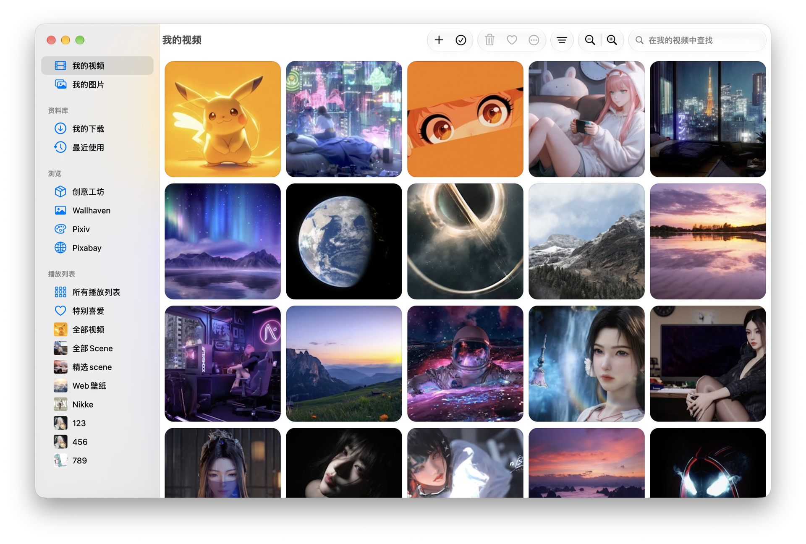
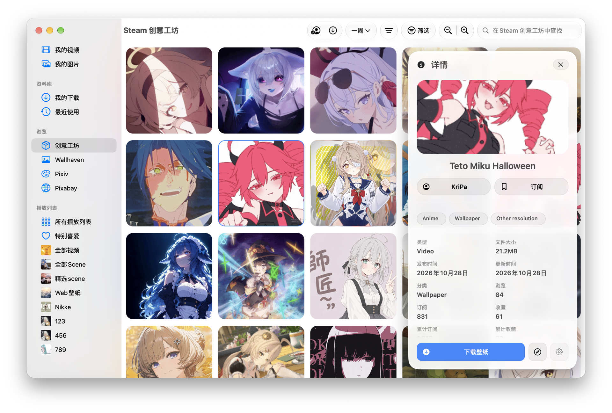
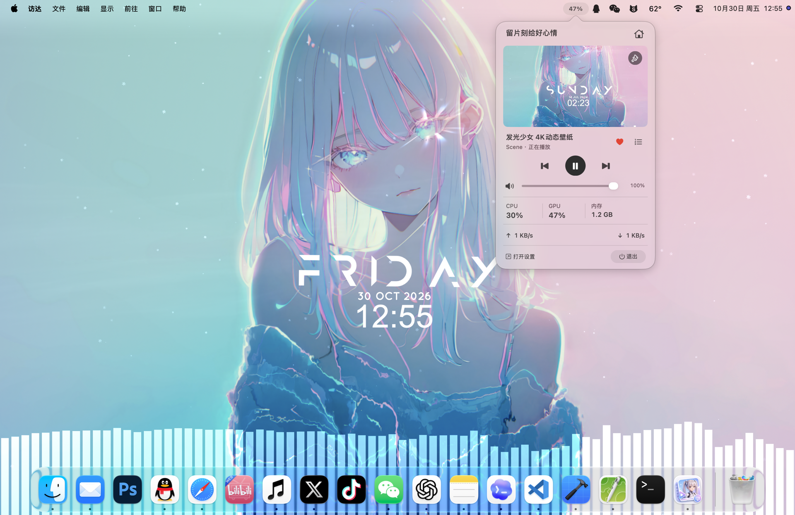
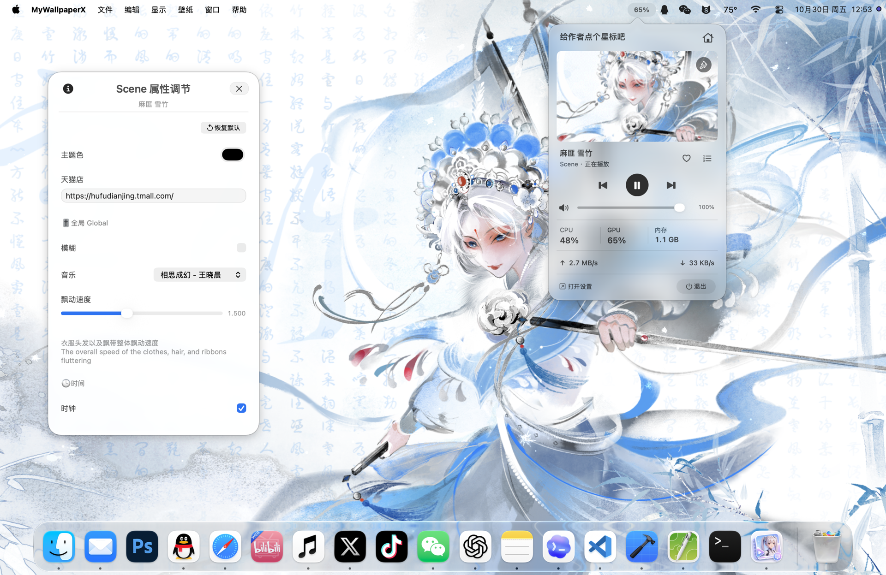

  

<h1 align="center">MyWallpaperX</h1>

<strong>Simple by intent. Pure by design.</strong>

A Wallpaper Engine–style wallpaper engine for macOS, with nothing to configure before your first wallpaper plays. Native · Animated · Open source

  <a href="README.md">简体中文</a> ·
  <a href="README.en.md">English</a>

  
  
  
  

  <a href="https://github.com/songziqiang9512/MyWallpaperX/releases/latest">Download</a> ·
  <a href="docs/releases/2.13.0.md">What's new in 2.13.0</a> ·
  <a href="https://www.mwpx.me">Website</a> ·
  <a href="https://github.com/songziqiang9512/MyWallpaperX/issues">Issues</a>

---

**MyWallpaperX** is an open-source wallpaper engine built for Apple Silicon Macs. It follows the semantics of Wallpaper Engine works on macOS and plays supported Scene and Web wallpapers, and it imports local video and images so you can build your own playlists, switch on a schedule, and follow along with the screen saver. The interface is native AppKit, so browsing and daily control feel like part of the system.

## A desktop worth looking at

<table align="center">
  <tr>
    <td width="50%" align="center">
      
       Local video · keep the clips you like
    </td>
    <td width="50%" align="center">
      
       Workshop · discover and download more
    </td>
  </tr>
  <tr>
    <td width="50%" align="center">
      
       Live desktop · controls within reach
    </td>
    <td width="50%" align="center">
      
       Properties · make it yours
    </td>
  </tr>
</table>

Click an image for the full size; the exact result depends on the build and the item.

## Pick the kind of wallpaper you want

| Kind | What you can do |
| --- | --- |
| **Video** | Import any local clip, set the fill mode, speed and volume, and play it on loop, in order, or shuffled. |
| **Web** | Play Web wallpapers and adjust the properties their authors expose: clocks, pointer interaction, audio visualisation and supported song info. |
| **Scene** | Render Scene wallpapers with Metal: layers, particles, text, plus supported model animation, video textures and script interaction. |
| **Still image** | Import a local image or download an online work, preview it, then set it as the desktop picture. The app can rotate it for you. |

Scene compatibility keeps growing, calibrated item by item against Wallpaper Engine's official works across materials, lighting, particles and script interaction. Some complex items still differ in effects, animation or interaction, and support for one capability does not mean every item of that kind is compatible. When something looks wrong, a report with the item ID and a screenshot is the fastest way to get it looked at.

### From discovery to collection

- **Local library**: search, favourites, tags and recently used keep material organised; switch between grid and list, open details, and use system Quick Look for local images and videos.
- **Playlists**: group animated wallpapers into playlists and rotate through installed Video, Web and Scene items.
- **Steam Workshop**: browse and search items, open author pages, subscribe and favourite; sign in with your own Steam account to download what your account can access, with one queue for downloads and local items.
- **Online sources**: find videos on Pixabay and browse images on Wallhaven and Pixiv, then search, preview and download. What you can see and download depends on the service and your account.
- **Item properties**: a native panel for the colours, values, options, text and file properties the author exposed, so compatible items fit your taste.

### The controls you reach for

- **Menu bar**: the current wallpaper and cover, play/pause, volume, previous and next, the rotation mode, and shortcuts to settings and properties.
- **Global hotkeys**: assign function keys in Settings to control playback, switch wallpapers and mute.
- **Resume and power saving**: restore the last wallpaper if you want it, and pause on full screen, focus loss, battery or idle.
- **Audio and song response**: compatible Web and Scene items can react to system audio; with song info enabled, supported items can show title, artwork and progress.
- **Scene HDR**: extended-range highlights on compatible displays, with a switch back to normal brightness.
- **Video screen saver**: pick a video from Lock Screen & Screen Saver settings or a local video card, then enable it in System Settings. It can pin one video or follow the most recently played one, keeps playing after the main app quits, and falls back to a still frame on battery.

## Stack and playback engines

**Stack**: Swift + AppKit for the interface and playback control; Metal for Scene rendering; AVFoundation for video; WebKit (WKWebView) for Web wallpapers; QuickJS-NG for SceneScript, with author shaders compiled to Metal through glslang / SPIRV-Cross; a separate .NET 10 + SteamKit2 service for Steam Workshop access; Sparkle for updates.

**Playback architecture**: the main app owns the interface, library, settings and user intent. Desktop windows, playback clocks, input and rendering run in separate background playback processes. The two sides exchange start, stop, property and status messages over bounded IPC, and main-window redraws never drive wallpaper frames. A switch prepares the new picture before the old one retires.

| Engine | How it plays |
| --- | --- |
| **Video** | A dedicated playback helper runs AVPlayer / AVPlayerLooper with an AVPlayerLayer inside the desktop window; the main app issues control and audio policy. |
| **Web** | A dedicated background AppKit host runs WKWebView, one surface per display; local resources are served through a controlled scheme, and properties, input and audio cross a versioned IPC bridge. |
| **Scene** | A dedicated Scene renderer parses the author's project into a typed program, resources and a render graph, runs QuickJS-NG for scripts, and composites each frame with Metal; particles advance through a data-driven interpreter. |
| **Still image** | Set directly through the system desktop interface, with no persistent renderer; the main app schedules rotation. |

## Install and start

**Requirements: macOS 26.0 or later, Apple Silicon (M-series). There is no Intel build.**

1. Download the DMG from [GitHub Releases](https://github.com/songziqiang9512/MyWallpaperX/releases/latest).
2. Open the DMG, drag `MyWallpaperX.app` into Applications, and launch it.
3. Import local video or images, or get items from an online source or the Steam Workshop.
4. Pick a wallpaper, then adjust properties, playlists and power settings as you like.

Release builds are signed with a Developer ID and notarised by Apple; later versions arrive through Check for Updates…. Published versions and installers are authoritative on [GitHub Releases](https://github.com/songziqiang9512/MyWallpaperX/releases).

The in-app Help menu carries an offline manual that ships with the build, covering the three engines, the Workshop, online sources, playback and power, displays and system settings. The interface speaks Simplified Chinese, English, Русский, Deutsch and Français, and follows the system language.

<strong>Notes</strong>

- Workshop downloads need your own account, working network access and permission to view the item.
- Wallhaven features such as account collections need a valid API key; Pixiv needs your own signed-in session.
- Online services and remote resources used by Web wallpapers depend on network and service state.
- Song info is off by default; enable it and grant the permission, and what it can show depends on the player and the item.
- In the Workshop search field, `ID=1234567890` jumps to an item; replace the digits with the real ID.
- More detail lives in the app's Help menu.

## Licence and notices

Except where third-party code, components or assets are noted otherwise, **MyWallpaperX's own code is licensed under GNU General Public License v3.0 (GPL-3.0-only)**. The full terms are in [LICENSE](LICENSE); project and third-party notices are in [NOTICE.md](NOTICE.md). Third-party components keep their own licences; wallpapers, fonts, images and audio/video works belong to their respective rights holders.

Source repository: [songziqiang9512/MyWallpaperX](https://github.com/songziqiang9512/MyWallpaperX). This is an independent open-source project with no affiliation or partnership with Valve, Steam, Wallpaper Engine, Pixabay, Wallhaven or Pixiv. Names, trademarks and works belong to their respective owners.

## Community and support

Report problems and suggestions through [Issues](https://github.com/songziqiang9512/MyWallpaperX/issues), or join the QQ group **569399751**. Include the app and macOS versions, your chip, and the steps to reproduce; for item problems, add the link or ID.

If you like MyWallpaperX, a [Star](https://github.com/songziqiang9512/MyWallpaperX) helps others find it — and matters for whether the project can keep being maintained.

Support the project voluntarily

  
  

Thank you. Supporting is voluntary and changes nothing about the rights the licence grants you.

