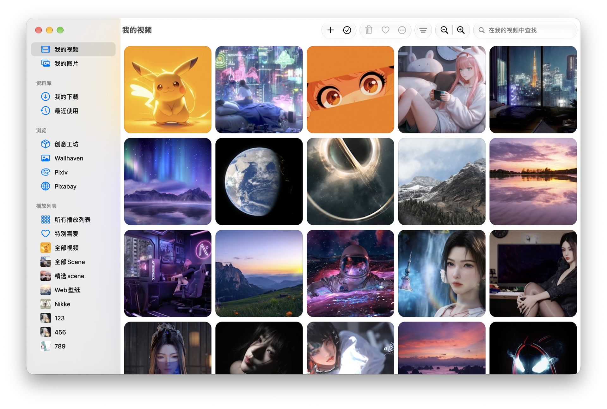
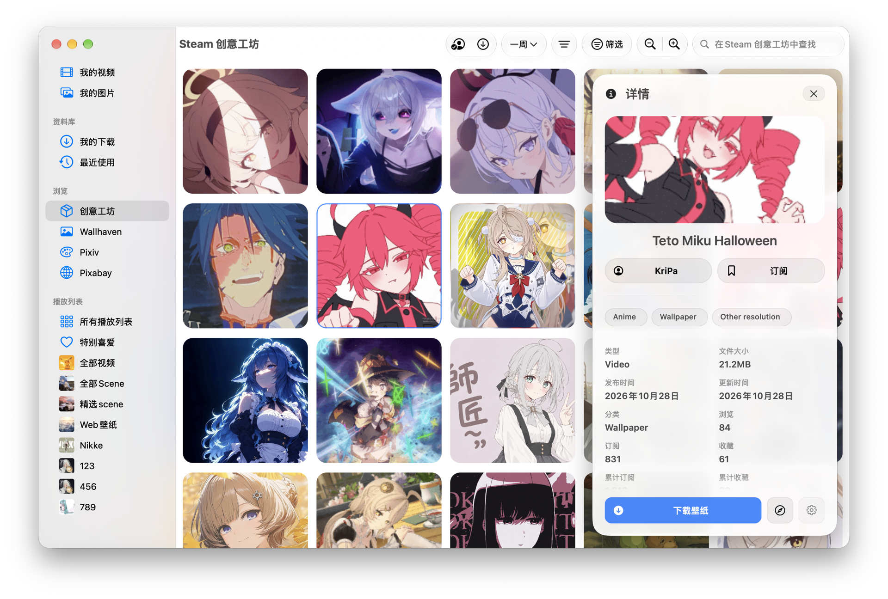
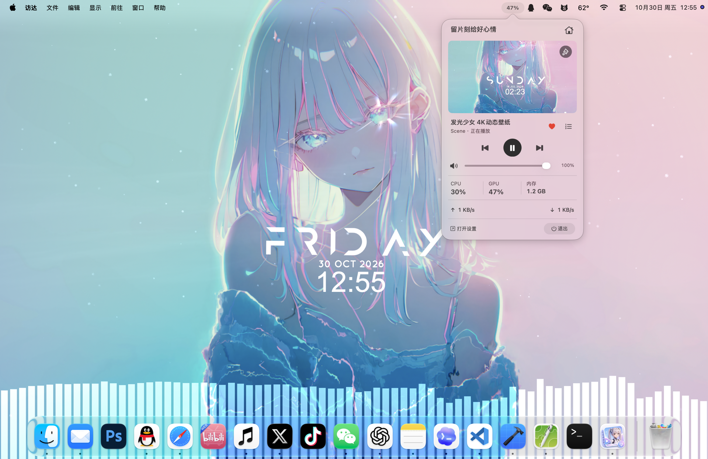
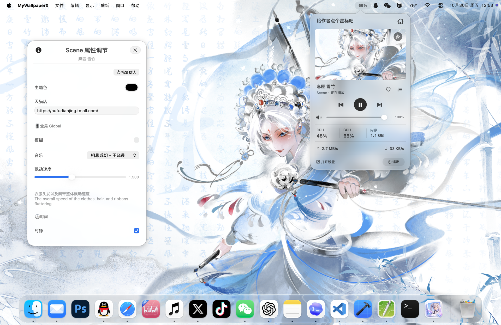

  

<h1 align="center">MyWallpaperX</h1>

<strong>Simple par choix. Pur par conception.</strong>

Un moteur de fonds d’écran à la manière de Wallpaper Engine pour macOS, sans rien à configurer avant que votre premier fond d’écran ne s’anime. Natif · Animé · Open source

  <a href="README.md">简体中文</a> ·
  <a href="README.en.md">English</a> ·
  <a href="README.ru.md">Русский</a> ·
  <a href="README.de.md">Deutsch</a> ·
  <a href="README.fr.md">Français</a>

  
  
  
  

  <a href="https://github.com/songziqiang9512/MyWallpaperX/releases/latest">Télécharger</a> ·
  <a href="docs/releases/2.12.4.md">Nouveautés de la version 2.12.4</a> ·
  <a href="https://www.mwpx.me">Site web</a> ·
  <a href="https://github.com/songziqiang9512/MyWallpaperX/issues">Issues</a>

---

**MyWallpaperX** est un moteur de fonds d’écran open source conçu pour les Mac Apple Silicon. Il reprend sur macOS la sémantique des œuvres Wallpaper Engine et affiche les fonds d’écran Scene et Web pris en charge ; il importe aussi des vidéos et des images locales, ce qui permet de constituer vos propres playlists, de changer de fond d’écran selon un calendrier et de suivre l’économiseur d’écran. L’interface est en AppKit natif : la navigation et les commandes du quotidien font partie du système.

## Un bureau qui mérite le coup d’œil

<table align="center">
  <tr>
    <td width="50%" align="center">
      
       Vidéos locales · gardez les séquences que vous aimez
    </td>
    <td width="50%" align="center">
      
       Workshop · en découvrir et en télécharger d’autres
    </td>
  </tr>
  <tr>
    <td width="50%" align="center">
      
       Bureau animé · les commandes à portée de main
    </td>
    <td width="50%" align="center">
      
       Propriétés · un bureau à votre image
    </td>
  </tr>
</table>

Cliquez sur une image pour l’afficher en grand ; le résultat exact dépend de la version et de l’œuvre.

## Choisissez le type de fond d’écran

| Type | Ce que vous pouvez faire |
| --- | --- |
| **Vidéo** | Importez n’importe quelle vidéo locale, réglez le mode de remplissage, la vitesse et le volume, puis lisez-la en boucle, dans l’ordre ou en aléatoire. |
| **Web** | Affichez des fonds d’écran Web et ajustez les propriétés exposées par leurs auteurs : horloges, interaction à la souris, visualisation audio et informations sur le morceau prises en charge. |
| **Scene** | Affichez les fonds d’écran Scene avec Metal : calques, particules, texte, ainsi que les animations de modèles, textures vidéo et interactions de script prises en charge. |
| **Image fixe** | Importez une image locale ou téléchargez une œuvre en ligne, prévisualisez-la, puis définissez-la comme fond d’écran du bureau. L’application peut se charger de la rotation. |

La compatibilité Scene continue de s’étendre : chaque œuvre est calibrée face aux œuvres officielles de Wallpaper Engine, sur les matériaux, l’éclairage, les particules et les interactions de script. Certaines œuvres complexes présentent encore des différences d’effets, d’animation ou d’interaction, et la prise en charge d’une capacité ne signifie pas que toutes les œuvres de ce type sont compatibles. En cas d’anomalie visuelle, un signalement accompagné de l’ID de l’œuvre et d’une capture d’écran est le moyen le plus rapide de la faire examiner.

### De la découverte à la collection

- **Bibliothèque locale** : la recherche, les favoris, les étiquettes et les éléments récemment utilisés organisent vos contenus ; alternez entre grille et liste, ouvrez les détails et utilisez Quick Look du système pour les images et vidéos locales.
- **Playlists** : regroupez des fonds d’écran animés en playlists et alternez entre les œuvres Vidéo, Web et Scene installées.
- **Steam Workshop** : parcourez et recherchez des œuvres, ouvrez les pages d’auteur, abonnez-vous et ajoutez aux favoris ; connectez-vous avec votre propre compte Steam pour télécharger ce à quoi votre compte a accès, avec une file d’attente unique pour les téléchargements et les œuvres locales.
- **Sources en ligne** : trouvez des vidéos sur Pixabay et parcourez des images sur Wallhaven et Pixiv, puis recherchez, prévisualisez et téléchargez. Ce que vous pouvez voir et télécharger dépend du service et de votre compte.
- **Propriétés des œuvres** : un panneau natif pour les propriétés de couleur, de valeur, d’option, de texte et de fichier exposées par l’auteur, afin que les œuvres compatibles s’ajustent à vos goûts.

### Les commandes du quotidien

- **Barre des menus** : le fond d’écran en cours et sa vignette, lecture/pause, volume, précédent et suivant, le mode de rotation, et des raccourcis vers les réglages et les propriétés.
- **Raccourcis globaux** : attribuez des touches de fonction dans les réglages pour contrôler la lecture, changer de fond d’écran et couper le son.
- **Reprise et économie d’énergie** : restaurez le dernier fond d’écran selon votre préférence, et mettez la lecture en pause en plein écran, à la perte de focus, sur batterie ou en cas d’inactivité.
- **Réaction à l’audio et aux morceaux** : les œuvres Web et Scene compatibles peuvent réagir à l’audio du système ; lorsque les informations sur le morceau sont activées, les œuvres prises en charge peuvent afficher le titre, la pochette et la progression.
- **Scene HDR** : des hautes lumières en plage étendue sur les écrans compatibles, avec un retour possible à une luminosité normale.
- **Économiseur d’écran vidéo** : choisissez une vidéo dans les réglages de l’écran verrouillé et de l’économiseur d’écran ou depuis la fiche d’une vidéo locale, puis activez-le dans les Réglages Système. Il peut épingler une seule vidéo ou suivre la plus récemment lue ; il continue de jouer après la fermeture de l’application principale et bascule sur une image fixe sur batterie.

## Pile technique et moteurs de lecture

**Pile technique** : Swift + AppKit pour l’interface et le contrôle de la lecture ; Metal pour le rendu Scene ; AVFoundation pour la vidéo ; WebKit (WKWebView) pour les fonds d’écran Web ; QuickJS-NG pour SceneScript, les shaders d’auteur étant compilés vers Metal via glslang / SPIRV-Cross ; un service séparé .NET 10 + SteamKit2 pour l’accès au Steam Workshop ; Sparkle pour les mises à jour.

**Architecture de lecture** : l’application principale prend en charge l’interface, la bibliothèque, les réglages et l’intention de l’utilisateur. Les fenêtres de bureau, les horloges de lecture, l’entrée et le rendu s’exécutent dans des processus de lecture en arrière-plan distincts. Les deux côtés échangent des messages de démarrage, d’arrêt, de propriété et d’état via une IPC bornée, et le redessin de la fenêtre principale ne pilote jamais les images du fond d’écran. Un changement prépare la nouvelle image avant le retrait de l’ancienne.

| Moteur | Mode de lecture |
| --- | --- |
| **Vidéo** | Un processus de lecture dédié exécute AVPlayer / AVPlayerLooper avec un AVPlayerLayer dans la fenêtre de bureau ; l’application principale émet les commandes et la politique audio. |
| **Web** | Un hôte AppKit dédié en arrière-plan exécute WKWebView, avec une surface par écran ; les ressources locales sont servies via un schéma contrôlé, et les propriétés, l’entrée et l’audio passent par un pont IPC versionné. |
| **Scene** | Un moteur de rendu Scene dédié analyse le projet de l’auteur en un programme typé, des ressources et un graphe de rendu, exécute QuickJS-NG pour les scripts et compose chaque image avec Metal ; les particules avancent via un interpréteur piloté par les données. |
| **Image fixe** | Application directe via l’interface de bureau du système, sans moteur de rendu persistant ; l’application principale planifie la rotation. |

## Installer et démarrer

**Configuration requise : macOS 26.0 ou version ultérieure, Apple Silicon (série M). Aucune version Intel n’est proposée.**

1. Téléchargez le DMG depuis [GitHub Releases](https://github.com/songziqiang9512/MyWallpaperX/releases/latest).
2. Ouvrez le DMG, glissez `MyWallpaperX.app` dans Applications, puis lancez-le.
3. Importez des vidéos ou des images locales, ou récupérez des œuvres depuis une source en ligne ou le Steam Workshop.
4. Choisissez un fond d’écran, puis ajustez les propriétés, les playlists et les réglages d’énergie selon vos besoins.

Les versions publiées sont signées avec un Developer ID et notariées par Apple ; les versions suivantes arrivent via la commande « Rechercher les mises à jour… ». Les versions publiées et les installateurs font foi sur [GitHub Releases](https://github.com/songziqiang9512/MyWallpaperX/releases).

Le menu « Aide » de l’application contient un manuel hors ligne livré avec la version installée, qui couvre les trois moteurs, le Workshop, les sources en ligne, la lecture et l’énergie, les écrans et les réglages système. L’interface est disponible en 简体中文, English, Русский, Deutsch et Français, et suit la langue du système.

<strong>Remarques</strong>

- Les téléchargements depuis le Workshop nécessitent votre propre compte, un accès réseau fonctionnel et l’autorisation de consulter l’œuvre.
- Des fonctions de Wallhaven comme les collections du compte nécessitent une clé API valide ; Pixiv nécessite votre propre session connectée.
- Les services en ligne et les ressources distantes utilisés par les fonds d’écran Web dépendent de l’état du réseau et des services.
- Les informations sur le morceau sont désactivées par défaut ; activez-les et accordez l’autorisation, sachant que ce qui peut être affiché dépend du lecteur et de l’œuvre.
- Dans le champ de recherche du Workshop, `ID=1234567890` ouvre directement une œuvre ; remplacez les chiffres par l’ID réel.
- Vous trouverez plus de détails dans le menu « Aide » de l’application.

## Licence et mentions légales

Sauf mention contraire pour du code, des composants ou des ressources tiers, **le code propre à MyWallpaperX est distribué sous licence GNU General Public License v3.0 (GPL-3.0-only)**. Les conditions complètes figurent dans [LICENSE](LICENSE) ; les mentions du projet et des tiers figurent dans [NOTICE.md](NOTICE.md). Les composants tiers conservent leurs propres licences ; les fonds d’écran, polices, images et œuvres audio/vidéo appartiennent à leurs détenteurs de droits respectifs.

Dépôt des sources : [songziqiang9512/MyWallpaperX](https://github.com/songziqiang9512/MyWallpaperX). Il s’agit d’un projet open source indépendant, sans affiliation ni partenariat avec Valve, Steam, Wallpaper Engine, Pixabay, Wallhaven ou Pixiv. Les noms, marques et œuvres appartiennent à leurs propriétaires respectifs.

## Communauté et soutien

Signalez les problèmes et les suggestions via [Issues](https://github.com/songziqiang9512/MyWallpaperX/issues), ou rejoignez le groupe QQ **569399751**, une communauté où les échanges se font en chinois. Indiquez la version de l’application et de macOS, votre puce et les étapes de reproduction ; pour un problème lié à une œuvre, ajoutez le lien ou l’ID.

Si vous aimez MyWallpaperX, une [Star](https://github.com/songziqiang9512/MyWallpaperX) aide d’autres personnes à le découvrir — et compte pour la continuité de la maintenance du projet.

Soutenir le projet de manière volontaire

  
  

Merci. Le soutien est volontaire et ne change rien aux droits que vous accorde la licence.

