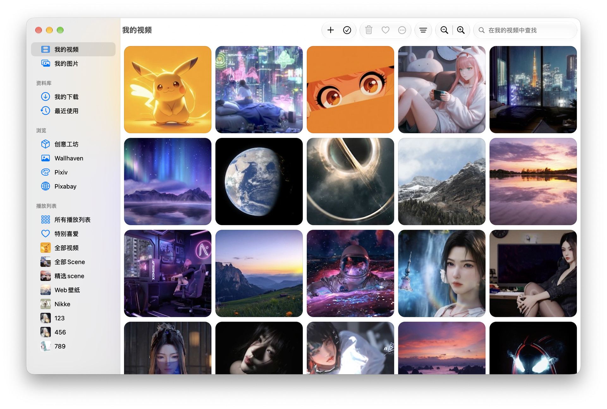
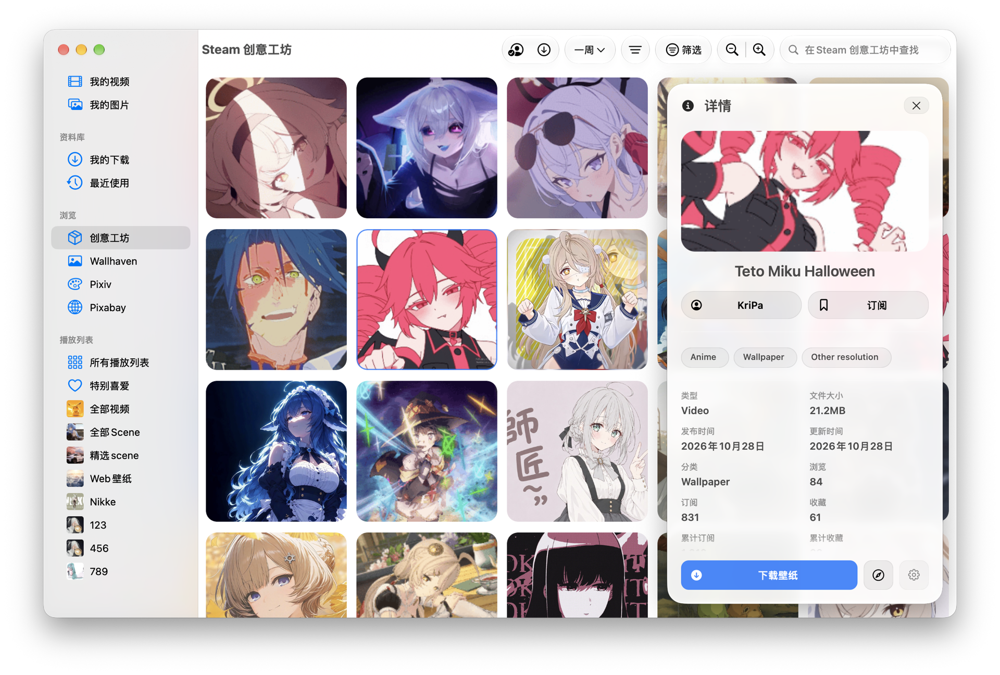
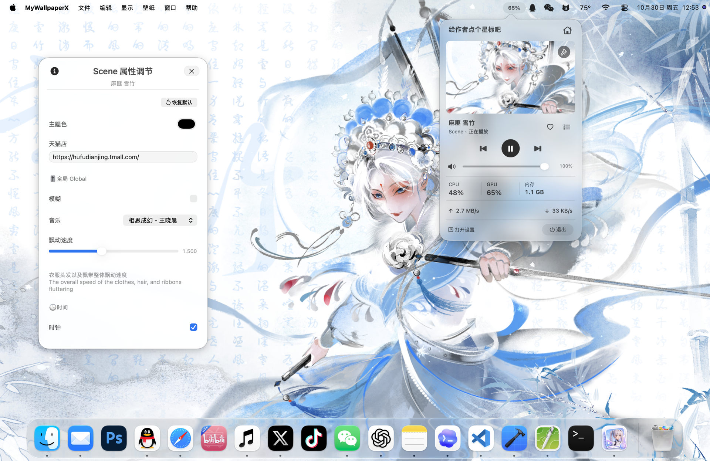

  

<h1 align="center">MyWallpaperX</h1>

<strong>初心至简，保持纯粹。</strong>

让喜欢的风景、影像与互动，成为 Mac 桌面的一部分。 原生体验 · 动态壁纸 · 开源自由

  
  
  
  

  <a href="https://github.com/songziqiang9512/MyWallpaperX/releases/latest">下载正式版</a> ·
  <a href="docs/releases/2.12.1.md">2.12.1 更新说明</a> ·
  <a href="https://www.mwpx.me">官方网站</a> ·
  <a href="https://github.com/songziqiang9512/MyWallpaperX/issues">问题反馈</a>

---

**MyWallpaperX** 是一款为 Apple Silicon Mac 打造的开源壁纸应用。把本地视频、静态图片、互动网页和实时场景带到桌面，在同一处发现、收藏、整理和播放喜欢的作品。界面以 macOS 原生控件构建，让浏览与日常控制自然融入系统。

## 看见喜欢的桌面

<table align="center">
  <tr>
    <td width="50%" align="center">
      
       本地视频 · 收藏与整理喜欢的影像
    </td>
    <td width="50%" align="center">
      
       创意工坊 · 发现与下载更多作品
    </td>
  </tr>
  <tr>
    <td width="50%" align="center">
      
       动态桌面 · 常用控制触手可及
    </td>
    <td width="50%" align="center">
      
       作品属性 · 调整属于自己的桌面
    </td>
  </tr>
</table>

点击图片查看大图，具体效果以版本与作品为准。

## 选择你的壁纸方式

| 类型 | 你可以做什么 |
| --- | --- |
| **视频壁纸** | 导入本地影像，调整填充方式、播放速度和音量，以循环、顺序或随机方式播放。 |
| **互动网页** | 播放 Web 壁纸，调整作者提供的属性，体验时钟、鼠标交互、音频可视化与受支持的歌曲信息展示。 |
| **实时场景** | 以 Metal 渲染 Scene 壁纸中的图层、粒子、文字，以及已支持的模型动画、视频纹理与脚本交互。 |
| **静态图片** | 导入本地图片，或下载在线作品，预览后设为系统桌面。通过应用自动切换能力，自动轮换。 |

Scene 兼容范围持续完善，部分复杂作品仍可能存在特效、动画或交互差异；支持某类能力不代表所有同类作品均已兼容。

### 从发现到收藏

- **本地资料库**：用搜索、收藏、标签和最近使用整理素材，切换网格与列表，查看详情；本地图片和视频支持系统 Quick Look 快速预览。
- **播放列表**：将喜欢的动态壁纸加入播放列表，统一整理与轮换，在已安装的视频、Web 和 Scene 作品间切换。
- **Steam 创意工坊**：浏览与搜索作品、查看作者主页、订阅和收藏；登录自己的 Steam 账号后下载可访问的内容，统一管理下载队列和本地作品。
- **在线发现**：从 Pixabay 寻找视频，也可浏览 Wallhaven 和 Pixiv 图片，搜索、预览并下载喜欢的作品。账号能力、可见内容与下载条件取决于对应来源。
- **作品属性**：用原生面板调整作者开放的颜色、数值、选项、文字及受支持的文件属性，让兼容作品更贴合个人喜好。

### 常用操作，触手可及

- **菜单栏控制面板**：查看当前壁纸和封面，直接暂停／继续、调节音量、切换上一张／下一张及轮换方式，快速进入设置和作品属性。
- **全局快捷键**：在设置中分配常用按键，随时控制播放、切换壁纸和静音。
- **恢复与节能**：按需恢复上次播放内容，并根据全屏、焦点、电池供电和电脑不活跃等状态暂停播放。
- **音频与歌曲响应**：兼容的 Web、Scene 作品可响应系统音频；启用歌曲信息后，可按作品实现展示标题、封面与进度。
- **HDR 场景**：在支持的屏幕上呈现兼容 Scene 作品的 HDR 高光，也可切换回普通亮度。
- **视频屏保**：从“锁屏与屏保”设置或本地视频卡片选择视频，保存后在系统设置中启用。可固定视频或跟随最近播放的视频；主 App 退出后仍可独立播放，使用电池时默认显示静帧。

## 安装与开始使用

**系统要求：macOS 26.0 或更新版本，Apple Silicon（M 系列芯片）。当前不提供 Intel 版本。**

1. 从 [GitHub Releases](https://github.com/songziqiang9512/MyWallpaperX/releases/latest) 下载正式版 DMG。
2. 打开 DMG，将 `MyWallpaperX.app` 拖入「应用程序」，然后启动应用。
3. 导入本地视频或图片，或从在线来源与 Steam 创意工坊获取作品。
4. 选择壁纸开始使用，按需要调整作品属性、播放列表和节能选项。

正式发行包采用 Developer ID 签名并经过 Apple 公证；应用内可通过「检查更新…」获取后续版本。已发布版本及安装包以 [GitHub Releases](https://github.com/songziqiang9512/MyWallpaperX/releases) 为准。

<strong>使用提示</strong>

- Steam 工坊下载需要自己的账号、可用网络与相应作品访问权限。
- Wallhaven 的账号收藏集等功能需要有效 API Key；Pixiv 需使用自己的登录会话。
- 在线服务及 Web 壁纸的远程资源可能受网络和服务状态影响。
- 歌曲信息默认关闭，按需启用并授予相应权限；可显示内容取决于播放器和作品支持情况。
- 在工坊总榜搜索框输入 `ID=1234567890` 可按作品 ID 查找，将数字替换为实际 ID。
- 更多操作说明可在应用的「帮助」菜单中查看。

## 开源许可与声明

除另有声明的第三方代码、组件与资源外，**MyWallpaperX 项目自有代码采用 GNU General Public License v3.0（GPL-3.0-only）开源许可**。完整条款见 [LICENSE](LICENSE)，项目与第三方声明见 [NOTICE.md](NOTICE.md)。第三方组件保留各自许可；壁纸、字体、图片及音视频作品的权利归相应权利人所有。

官方源码仓库：[songziqiang9512/MyWallpaperX](https://github.com/songziqiang9512/MyWallpaperX)。本项目是独立开源项目，与 Valve、Steam、Wallpaper Engine、Pixabay、Wallhaven 或 Pixiv 没有隶属或官方合作关系。相关名称、商标和作品归各自权利人所有。

## 交流与支持

欢迎通过 [Issues](https://github.com/songziqiang9512/MyWallpaperX/issues) 提交问题和建议，或加入 QQ 群 **569399751** 交流。反馈时请附上应用与 macOS 版本、芯片型号、复现步骤；作品相关问题请提供链接或 ID。

如果喜欢 MyWallpaperX，欢迎点亮 [Star](https://github.com/songziqiang9512/MyWallpaperX)，让更多人发现它。

自愿支持项目开发

  
  

感谢支持。赞助完全自愿，不改变开源许可证授予的权利。

