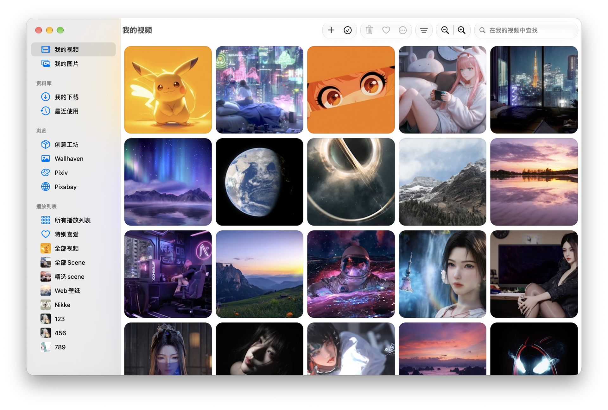
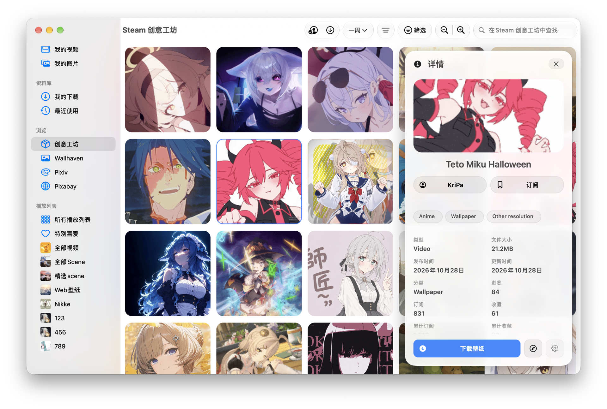
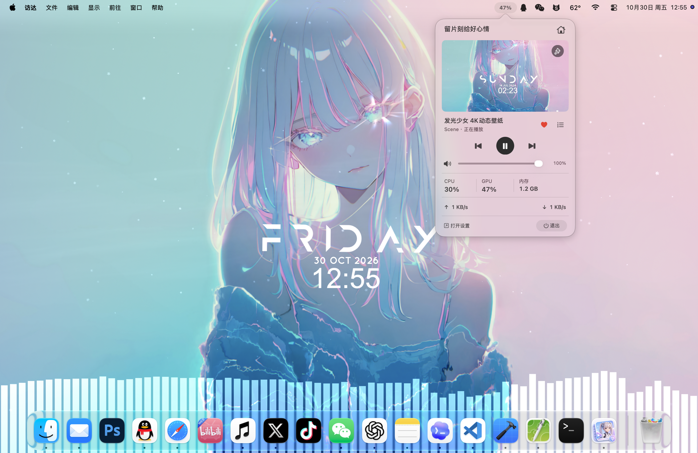
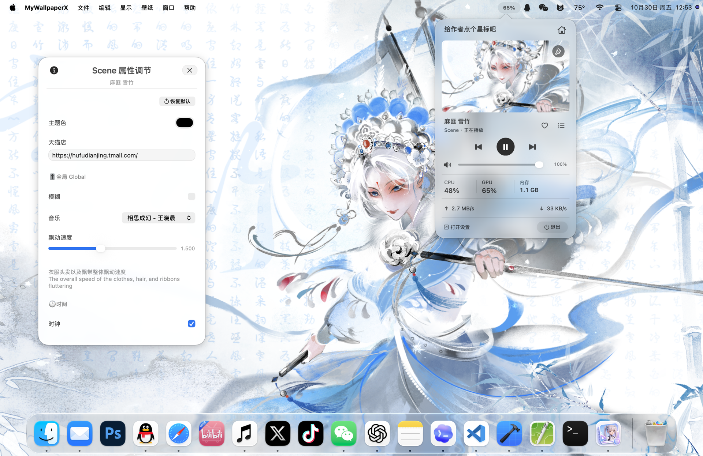

  

<h1 align="center">MyWallpaperX</h1>

<strong>Простота в замысле. Чистота в исполнении.</strong>

Движок обоев в духе Wallpaper Engine для macOS — прежде чем заработают первые обои, настраивать ничего не нужно. Нативный · Анимированный · С открытым исходным кодом

  <a href="README.md">简体中文</a> ·
  <a href="README.en.md">English</a> ·
  <a href="README.ru.md">Русский</a> ·
  <a href="README.de.md">Deutsch</a> ·
  <a href="README.fr.md">Français</a>

  
  
  
  

  <a href="https://github.com/songziqiang9512/MyWallpaperX/releases/latest">Скачать</a> ·
  <a href="docs/releases/2.12.4.md">Что нового в 2.12.4</a> ·
  <a href="https://www.mwpx.me">Сайт</a> ·
  <a href="https://github.com/songziqiang9512/MyWallpaperX/issues">Issues</a>

---

**MyWallpaperX** — движок обоев с открытым исходным кодом, созданный для Mac с Apple Silicon. Он воспроизводит поддерживаемые Scene- и Web-обои по тем же правилам, что и работы Wallpaper Engine в macOS, а также импортирует локальные видео и изображения, чтобы вы могли собирать собственные плейлисты, менять обои по расписанию и согласовывать воспроизведение с экранной заставкой. Интерфейс построен на нативном AppKit, поэтому просмотр и повседневное управление воспринимаются как часть системы.

## Рабочий стол, на который стоит смотреть

<table align="center">
  <tr>
    <td width="50%" align="center">
      
       Локальные видео · храните понравившиеся ролики
    </td>
    <td width="50%" align="center">
      
       Мастерская · находите и скачивайте больше работ
    </td>
  </tr>
  <tr>
    <td width="50%" align="center">
      
       Анимированный рабочий стол · управление под рукой
    </td>
    <td width="50%" align="center">
      
       Свойства · настройте обои под себя
    </td>
  </tr>
</table>

Нажмите на изображение, чтобы увидеть его в полном размере; конкретный вид зависит от сборки и работы.

## Выберите тип обоев

| Тип | Что можно делать |
| --- | --- |
| **Видео** | Импортируйте любой локальный ролик, настройте режим заполнения, скорость и громкость и воспроизводите его циклически, по порядку или в случайном порядке. |
| **Web** | Воспроизводите Web-обои и настраивайте свойства, которые предоставляют их авторы: часы, взаимодействие с указателем, визуализацию звука и поддерживаемые сведения о песне. |
| **Scene** | Воспроизводите Scene-обои средствами Metal: слои, частицы, текст, а также поддерживаемую анимацию моделей, видеотекстуры и взаимодействие со скриптами. |
| **Статическое изображение** | Импортируйте локальное изображение или скачайте работу из онлайн-источника, просмотрите её и установите как обои рабочего стола. Приложение может автоматически менять их. |

Совместимость Scene продолжает расширяться: каждая работа отдельно калибруется по официальным работам Wallpaper Engine — по материалам, освещению, частицам и взаимодействию со скриптами. Некоторые сложные работы всё ещё отличаются по эффектам, анимации или взаимодействию, а поддержка одной возможности не означает, что совместимы все работы этого типа. Если что-то выглядит неправильно, быстрее всего рассмотреть проблему поможет сообщение с ID работы и скриншотом.

### От поиска до коллекции

- **Локальная библиотека**: поиск, избранное, теги и недавно использованные элементы помогают упорядочивать материалы; переключайтесь между сеткой и списком, открывайте подробности и используйте системный «Быстрый просмотр» для локальных изображений и видео.
- **Плейлисты**: объединяйте анимированные обои в плейлисты и переключайтесь между установленными видео, Web- и Scene-обоями.
- **Мастерская Steam**: просматривайте и ищите работы, открывайте страницы авторов, подписывайтесь и добавляйте в избранное; войдите в свою учётную запись Steam, чтобы скачивать доступные вам материалы — загрузки и локальные работы используют единую очередь.
- **Онлайн-источники**: ищите видео на Pixabay, просматривайте изображения на Wallhaven и Pixiv, а затем ищите нужное, просматривайте его и скачивайте. Что доступно для просмотра и скачивания, зависит от сервиса и вашей учётной записи.
- **Свойства работы**: нативная панель для цветов, числовых значений, вариантов выбора, текста и свойств файлов, которые предоставляет автор, чтобы совместимые работы соответствовали вашему вкусу.

### Управление под рукой

- **Строка меню**: текущие обои и обложка, воспроизведение/пауза, громкость, предыдущие и следующие обои, режим смены, а также быстрый доступ к настройкам и свойствам.
- **Глобальные горячие клавиши**: назначайте в настройках функциональные клавиши для управления воспроизведением, переключения обоев и отключения звука.
- **Восстановление и энергосбережение**: по желанию восстанавливайте последние обои и приостанавливайте воспроизведение при переходе в полноэкранный режим, потере фокуса, работе от батареи или простое.
- **Реакция на звук и песни**: совместимые Web- и Scene-обои могут реагировать на системный звук; если сведения о песне включены, поддерживаемые обои могут показывать название, обложку и прогресс.
- **Scene HDR**: светлые участки расширенного диапазона на совместимых дисплеях с возможностью вернуться к обычной яркости.
- **Экранная заставка с видео**: выберите видео в настройках «Экран блокировки и экранная заставка» или на карточке локального видео, затем включите заставку через «Системные настройки». Она может закрепить одно видео или следовать за последним воспроизведённым видео; заставка продолжает воспроизводиться после закрытия основного приложения и при работе от батареи переключается на статичный кадр.

## Стек и движки воспроизведения

**Стек**: Swift + AppKit для интерфейса и управления воспроизведением; Metal для рендеринга Scene; AVFoundation для видео; WebKit (WKWebView) для Web-обоев; QuickJS-NG для SceneScript, при этом шейдеры авторов компилируются в Metal через glslang / SPIRV-Cross; отдельный сервис .NET 10 + SteamKit2 для доступа к Мастерской Steam; Sparkle для обновлений.

**Архитектура воспроизведения**: основное приложение отвечает за интерфейс, библиотеку, настройки и намерения пользователя. Окна рабочего стола, часы воспроизведения, ввод и рендеринг работают в отдельных фоновых процессах воспроизведения. Обе стороны обмениваются сообщениями о запуске, остановке, свойствах и состоянии через IPC с ограничениями, а перерисовка главного окна не управляет выводом кадров обоев. При переключении новое изображение подготавливается до того, как завершится работа старого.

| Движок | Как воспроизводится |
| --- | --- |
| **Видео** | Отдельный процесс-помощник воспроизведения запускает AVPlayer / AVPlayerLooper с AVPlayerLayer внутри окна рабочего стола; основное приложение отдаёт команды управления и определяет политику работы со звуком. |
| **Web** | Отдельный фоновый процесс-хост AppKit запускает WKWebView, по одной поверхности на дисплей; локальные ресурсы отдаются через контролируемую схему, а свойства, ввод и звук проходят через мост IPC с версионированием. |
| **Scene** | Отдельный рендерер Scene преобразует проект автора в типизированную программу, ресурсы и граф рендеринга, запускает QuickJS-NG для скриптов и компонует каждый кадр с помощью Metal; частицы обновляет управляемый данными интерпретатор. |
| **Статическое изображение** | Устанавливается напрямую через системный интерфейс рабочего стола, без постоянно работающего рендерера; смену обоев планирует основное приложение. |

## Установка и запуск

**Требования: macOS 26.0 или новее, Apple Silicon (чипы серии M). Сборки для Intel нет.**

1. Скачайте DMG из [GitHub Releases](https://github.com/songziqiang9512/MyWallpaperX/releases/latest).
2. Откройте DMG, перетащите `MyWallpaperX.app` в папку «Программы» и запустите приложение.
3. Импортируйте локальные видео или изображения либо получите работы из онлайн-источника или Мастерской Steam.
4. Выберите обои и настройте свойства, плейлисты и параметры энергосбережения по своему усмотрению.

Релизные сборки подписаны Developer ID и прошли нотаризацию Apple; последующие версии приходят через пункт «Проверить обновления…». Актуальными считаются опубликованные версии и установщики на [GitHub Releases](https://github.com/songziqiang9512/MyWallpaperX/releases).

Меню «Справка» в приложении содержит офлайн-руководство, поставляемое вместе со сборкой; оно охватывает три движка, Мастерскую, онлайн-источники, воспроизведение и энергопотребление, дисплеи и системные настройки. Интерфейс доступен на упрощённом китайском, английском, русском, немецком и французском языках и подстраивается под язык системы.

<strong>Примечания</strong>

- Для загрузки из Мастерской нужны собственная учётная запись, доступ к сети и разрешение на просмотр работы.
- Для таких функций Wallhaven, как коллекции в учётной записи, нужен действующий ключ API; для Pixiv — собственный сеанс с выполненным входом.
- Онлайн-сервисы и удалённые ресурсы, используемые Web-обоями, зависят от состояния сети и сервисов.
- Сведения о песне по умолчанию отключены; включите их и предоставьте разрешение — отображаемые сведения зависят от плеера и работы.
- В поле поиска Мастерской введите `ID=1234567890`, чтобы открыть работу; замените цифры на настоящий ID.
- Подробности — в меню «Справка» приложения.

## Лицензия и уведомления

Если для стороннего кода, компонентов или ресурсов не указано иное, **собственный код MyWallpaperX распространяется по лицензии GNU General Public License v3.0 (GPL-3.0-only)**. Полные условия приведены в [LICENSE](LICENSE), уведомления проекта и третьих сторон — в [NOTICE.md](NOTICE.md). Сторонние компоненты распространяются по собственным лицензиям; права на обои, шрифты, изображения и аудио- и видеопроизведения принадлежат соответствующим правообладателям.

Репозиторий с исходным кодом: [songziqiang9512/MyWallpaperX](https://github.com/songziqiang9512/MyWallpaperX). Это независимый проект с открытым исходным кодом, не аффилированный с Valve, Steam, Wallpaper Engine, Pixabay, Wallhaven и Pixiv и не состоящий с ними в партнёрстве. Названия, товарные знаки и работы принадлежат соответствующим владельцам.

## Сообщество и поддержка

Сообщайте о проблемах и предложениях через [Issues](https://github.com/songziqiang9512/MyWallpaperX/issues) или присоединяйтесь к китайскоязычному сообществу в QQ — группе **569399751**. Укажите версии приложения и macOS, модель чипа и шаги воспроизведения; если проблема касается конкретной работы, приложите ссылку или ID.

Если вам нравится MyWallpaperX, [Star](https://github.com/songziqiang9512/MyWallpaperX) помогает другим найти его — и влияет на то, будет ли он и дальше поддерживаться.

Поддержать проект добровольно

  
  

Спасибо. Поддержка добровольна и никак не меняет права, предоставленные вам лицензией.

