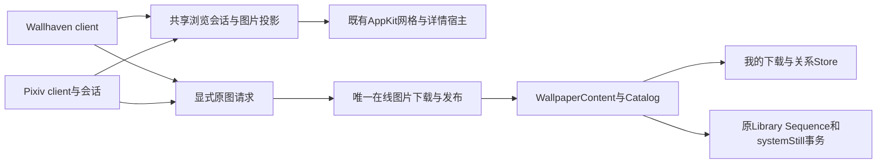

# Wallhaven 在线浏览接入方案

<!-- document-role: active-plan -->

更新日期：2026-10-27。最初侦查基线：`8f71545d8962e16d401c79c5866e97ca9ddc554b`；本轮整合基线：`2fb50b5f14b53410a7479ce474c9999376b4e174`。
工作树：`MWX/status-menu-design`。设计与共享合同见§1–8，已实施范围、实证和未覆盖项见§9；基于目标分支最新UI与启动专项提交整合，未改主仓工作区。

## 1. 用户结果与首版范围

侧栏“浏览”的在线内容依次为创意工坊、Wallhaven、Pixiv、Pixabay；已退役的独立订阅页不恢复，Steam订阅继续由其现有入口管理。两项均为原生AppKit页面，沿用现有工具栏、方形网格、详情面板和背景轻染；不把网站整页作为产品浏览界面。

Wallhaven首版闭环：浏览/搜索 → 按需详情 → 下载原图 → 统一“我的下载” → 设为静态壁纸 → 本地喜爱/播放列表 → 重启后离线可用。原图只在用户下载或明确“下载并设为壁纸”时获取。

本轮不接账号收藏/集合写入、不迁移Pixabay视频实现、不新建壁纸渲染进程、不做全站抓取或后台预下载。高级筛选按已验证能力逐项开放，不能用无效控件凑齐参考项目功能。

## 2. 已查清的现状与方案取舍

| 当前源码 | 接入影响 |
|---|---|
| `Models/WallpaperReference.swift`的provider目前只有四种 | 增加`.wallhaven/.pixiv`，沿用opaque ID，不能拿本地路径或文件后缀充当来源身份 |
| `Models/WallpaperLibraryPage.swift`、`Shell/WallpaperLibrarySidebarController.swift` | 增加两页、稳定导航key和浏览分组入口，不借Pixabay页切换来源 |
| `Modules/OnlineLibrary/Core/PixabayService.swift` | 当前是Pixabay视频、Int ID和MP4下载，不能直接承接图片 |
| `Shell/WallpaperLibraryGridController.swift`与Shared网格/控件/Inspector | 已有布局、输入、焦点、模态及缩略图需求规则，复用而非重写另一种网格 |
| `App/WallpaperLibraryCatalogController.swift:publish` | 当前下载是Steam/Pixabay成对拼接；必须改为按provider替换自己的子集，保留其他来源 |
| `Core/LibraryCollections/WallpaperLibraryQuery.swift`、`App/WallpaperLibraryWindowToolbar.swift` | 下载来源写死两种，且下载筛选跳过image；两处必须一并扩充 |
| `App/WallpaperLibraryPlaybackRouting.swift` | 继续调用`manager.setStaticWallpaper(url, libraryPending:)`，不在新模块直接调用NSWorkspace |
| `App/WallpaperLibraryPlaybackRestoration.swift`、Workspace及DownloadRecovery | 补齐下载来源依赖、显式恢复和重试分发，不能把新增来源默认视为已加载或不可恢复 |
| `Core/LibraryCollections/UserCollectionsStore.swift` | 收藏、列表、最近及aliases已有唯一owner；远端未发布卡不具有organize/play能力 |

选择“来源适配器 + 两来源共用在线图片获取/发布 + 现有Shell/关系/播放事务”。另两种选择均不采用：把Pixabay视频服务强行泛化会混入格式和迁移风险；两站各建网格、下载和缓存会产生重复链。共享只覆盖这两个真实图片消费者，不建立任意站点插件平台。

视觉与交互以[主界面方案](main-window-playlists-redesign.md)的§4–6及§16为准；缩略图生命周期以[AppKit合同](../architecture/appkit-migration.md)为准。本文不复写其尺寸和颜色数值。

## 3. 在线接口的证据与P0边界

[Wallhaven官方API入口](https://wallhaven.cc/help/api)的浏览器读取曾返回403；实施P0改用普通HTTP读取已获得200与完整帮助正文。官方确认45次/分钟、固定24项分页、API key可用`X-API-Key`、NSFW需key；本项目只用header。已实测匿名SFW搜索、详情、过滤末页、零结果及一张1920×1080原图；实际限流header为45。`meta.query`实际可为字符串、tag对象或null，不沿用参考的单一字符串假设。

官方文档的random seed与本次服务行为不一致：同一`seed=abcdef&page=1`两次请求都返回不同seed和不同作品顺序。首版随机仅取一批并提示不连续翻页，稳定排序正常分页；不增加补偿性重试。无真实key，认证/NSFW仍未验收。脱敏P0证据放本任务忽略目录`.artifacts/online-sources/p0-wallhaven/`，不包含用户凭据。

参考根为主仓忽略目录`Reference Project/WaifuX-main`，只读研究、独立实现：

| 参考位置 | 可借鉴或应避免的行为 |
|---|---|
| `Models/WallhavenAPI.swift:33–79` | typed查询、API key header；`perPage=8`并不证明可控制服务端页大小 |
| 同文件`:129–179` | 候选q/category/purity/sort/order/topRange/resolution/ratio/color/seed；`per_page/include_fields`不直接纳入本项目合同，多色也不能只发第一项 |
| `ViewModels/WallpaperViewModel.swift:941,1126` | 保存首响应seed、按ID去重；还须冻结整份查询和凭据修订 |
| 同文件`:737`及`Views/WallpaperDetailSheet.swift:1403` | 打开详情才补作者，不对每张卡请求详情 |
| `Models/Wallpaper.swift:157`及`Models/WallhavenAPI.swift:193` | 不照搬由ID/扩展名猜原图URL；只消费真实path |
| `ViewModels/WallpaperViewModel.swift:1572,1619` | 默认隐藏人物/竖图是参考产品策略，本项目不隐式继承 |

P0只做少量只读请求，先检查候选`GET https://wallhaven.cc/api/v1/search`及`GET /api/v1/w/{id}`。记录：

1. 无凭据SFW查询/详情是否可用，HTTP、JSON envelope和错误类型；无法读取就记录外部阻塞，不改用第三方代理或HTML爬虫。
2. `id/url/path/thumbs`、尺寸、MIME、大小、category/purity、日期等实际字段；作者、tags、source允许缺失，缺source不改变provider。
3. 分页`current_page/last_page/per_page/total`和空页/末页行为；响应per_page不推导同名请求参数受支持。
4. random首响应seed及同查询后续页复现；刷新或筛选变化建立新会话，不沿用旧seed。
5. q、category/purity位掩码、排序及分辨率/比例/颜色的真实语义；toplist参数名及组合优先级核实后才开放。
6. 可选认证的header、失效key及权限响应；无测试凭据时明确未验证，不读取用户已存凭据。仅在已确认的匿名能力上推进首版。

每站仅一个API限流owner，采用1在途、请求启动间隔1秒的本地保守策略，首请求不等待；这是本地策略。按真实Retry-After/429退避，不故意打满配额。缩略图/CDN下载不套用API次数计数，不叠多层重试和外层超时。

## 4. 两个新来源的共享接入合同

本节是Wallhaven/Pixiv共用部分的唯一设计权威；[Pixiv方案](pixiv-online-browser-design.md)只补站点差异。实施公共文件由一个整合者负责，来源client可并行。

### 4.1 职责和目录

路径是计划职责，不表示已有实现；产品实施时按最近职责收敛，文件保持1000行以下。

| 计划职责 | 放置/既有接线点 | 不拥有 |
|---|---|---|
| 站点DTO、Query、client、按需详情 | `Modules/Wallhaven/Core/`、`Modules/Pixiv/Core/` | 网格布局、关系、播放计时 |
| 图片值、两来源共用浏览会话、下载/发布 | `Core/OnlineImages/`；来源特定Query保留类型，不用任意字典抹平 | 站点认证、Shell页面、全库数据库 |
| 两个浏览页及图片卡 | `Shared/UI/OnlineImageBrowserController.swift`、`OnlineImageGridItem.swift`，消费既有Grid/控件/Inspector | 第二个collection布局、缓存和播放状态 |
| 页面装配与能力路由 | `App/`显式装配；必要时按职责扩展现Composition，不继续往单文件堆分支 | service locator/插件注册平台 |
| 用户关系与播放 | 原Workspace/Query/Commands/Store/Sequence | 远端全站扫描和认证 |

浏览会话只拥有查询、页token、结果、失败和请求代次；Shell继续拥有当前页、缩放、滚动锚点和命令域。来源专用筛选/排序/搜索只在typed Query保存一份，工具栏读写该Query，不与Shell通用search再互相镜像。借用Grid处理远端值时，远端页面不进入本地Catalog，不启用本地下拉计数、拖入列表或删除文件。浏览容器实现原`ListThumbnailTintProviding`和网格可见/退出回调，沿原首内容轻染及模态输入边界，不另建滚动观察时钟。

一个新在线图片publication owner管理两站的本地文件、下载任务和记录。它不导入SIL生成第二UUID/索引；本地图片卡可复用SIL现有路径缩略图provider，文件可用性仍归此publication owner。Pixabay视频、Steam获取和用户自己导入的图片继续归原owner。

### 4.2 身份、记录和持久化

- Wallhaven：`WallpaperReference(provider:.wallhaven, sourceID:原始作品ID)`；不把数字化、大小写改写或URL文件名作为归一化捷径。
- Pixiv：作品ID与图片页分开；本地资产为`.pixiv / "{illustID}:p{0-based}"`。浏览作品壳不能伪装本地已发布图片，细则见Pixiv方案。
- 共用本地版本化manifest，记录provider、资产ID、作品/作者/来源页、相对本地路径、像素/字节大小、首次成功下载时间、当前发布revision。API key、Cookie、登录身份私有响应不进入记录或个人设置。
- 文件按来源分目录，路径只作locator；发布用记录里的身份，不扫描文件名猜来源。记录只由该owner写，用户关系仍只写原Store；不保存第二份喜爱、最近或队列。
- manifest损坏保留原件并报告；不得把目录里任意图片当成成功下载。既有有效本地发布不因API离线、key丢失、Cookie失效而失去播放资格。
- 当前关系DB v2存储通用ref_key，没有四来源SQL白名单；不为加枚举无故升级DB。个人设置目前schema7：新增来源/页类型必须做旧1–7导入与新格式往返；输出使用新schema8，让不理解新来源的旧版明确拒绝且保留原文件。同步审查所有`==7`分支为等价版本范围，不只改版本常量；不迁移媒体文件。
- reset/个人设置导入、来源缺失、移除/重新下载及aliases沿原合同验收。缺少下载资产的关系显示不可用，不能按标题/路径重新绑定其他作品。

### 4.3 请求、分页和缓存

完整请求身份包含来源、typed Query、页token、认证作用域/修订和generation。搜索A→B、刷新、取消与返回只由会话owner结算；旧完成不能清掉新loading。每页单flight，成功才推进页token；失败重试原页，按服务端continuation判到尾，不能按去重后/过滤后数量判断。

保留当前查询结果及一次作者/详情返回上下文，不存无限历史或整站索引。离开页面取消只为该页存在的请求/预取，保留模型与锚点；显式下载不随离页取消。同查询5分钟内重入不自动重新拉取；过期先显示缓存，后台只核首页。元数据原位更新；成员/顺序变化提示“有新内容可刷新”，不偷偷重排已翻页网格。手动刷新明确重置分页/随机seed，失败保留旧结果并给重试。五分钟是本项目策略，不是网站承诺。

作者列表的后台校验仅更新既有ID的元数据，保持ID快照与续页offset配对；手动刷新、类型或作用域更换才重建快照，避免后台替换快照导致漏页。

详情只在点击后获取，按来源ID/作用域合并；30分钟内可复用，最多保留96项，插入时淘汰最旧项，不设后台清理时钟。过期先显示已有内容再补齐。缺字段真实留空，不假造上传者/总数；不能全卡N+1详情请求。

缩略图复用现`OnlineImageThumbnailCache`、coordinator/scheduler和`GridThumbnailDecoder`，不再加两站各自缓存。为现唯一pipeline增加最小“来源/资源版本/作用域/像素档/transport”请求值，使Pixiv专用session可带必要Referer；Pixabay原URL键和现取消/清缓存代次语义保持。认证或原始Cookie不作为键文本，授权请求不经默认全局cookie session。不同作用域不能借旧图；注销按Pixiv方案清理其作用域。解码清理仅遍历实际驻留键，raw索引只跟踪实际发布到内存的URL，超过两倍工作集才按内存事实压缩；磁盘namespace在作用域失效事件清理，不持有无限历史URL或增加轮询。

内存就绪立即回显、暖盘后台读取、显示图不随缓存淘汰消失；可见与近邻共用请求/租约，可见提升、最后消费者撤销才取消。共用既有内存/磁盘预算，不为每站另开预算；磁盘trim、解码、首访缓存维护不进主线程或普通layout。隐藏/关闭停止预取，当前封面不因进度/元数据刷新清空。不加定时轮询、GIF常驻或后台预编译。

### 4.4 下载、取消、发布和应用

1. 点击下载时捕获精确资产、来源解析及任务ID；按需补齐原图URL和作者/标签元数据，不猜URL/扩展名，不把缩略图降级冒充原图。
2. 复用/抽出当前`OLDownloadTaskDelegate`中真正通用的流式下载、取消和节流部分，Pixabay仍由原service拥有记录和应用准入；不复制第二个delegate。新图片任务统一由在线图片owner去重、排队、取消和重试。
3. 原图用downloadTask落本任务staging，后台识别真实图片类型和metadata；拒绝HTML/坏图、越界尺寸和非支持格式。只为阻止假入库/解码越界做一次必要检查，不全图主线程解码、不增加逐次播放摘要验证。
4. 发布在同目录原子重命名；manifest用同owner的原子写入作为提交点。每个新revision使用独立文件名，提交前manifest仍指旧文件，不能先覆盖旧字节；记录写失败回滚本次文件。旧revision由同manifest保留待退役信息，回收复用`manager.isLocalSourceFileInUse`保护committed/pending/cancel/retire引用；重启后系统桌面可能仍持旧URL，不能以无App票据或不在现revision就认定可删，系统引用无法确认退出时先保留。仅明确未提交的staging可自动清理，不从孤立文件猜来源。不加后台回收轮询。取消与提交在同一owner线性化：提交前取消无发布，提交后取消不删除已发布资产。
5. 仅成功提交才发布`.image/.available`及play/organize/reveal/delete等能力，再进入Catalog/我的下载；`.remote`卡仅inspect/download/openSource。进度按当前任务ID节流，更新对应卡片，不让每个网络tick重载整个网格。
6. 仅“下载并设为壁纸”保留待应用副作用。复用现`ImportedVideoAutoplayGate`同一generation机制和产品intent epoch，在最终消费点核对；不能把图片塞入强制`.video`的`ImportedVideoPlaybackAdmission`。不得新建图片autoplay gate，更不能调用`beginPlaybackIntent(nil)`占位而先停止当前壁纸。文件就绪后才沿原Sequence接纳`.systemStill`票据并交现Manager应用。用户改播/Stop/新一次下载并应用后，旧任务可完成入库但不能抢桌面。
7. 静态应用失败保留原壁纸，最近只按真实成功提交记录。下载不等于设壁纸成功；不以本地文件已存在绕过原意图/事务。
8. 删除交给唯一publication owner，关系删除与实体删除沿既有命令事务分别处理；局部失败保留对应记录及错误。重试、覆盖和原下载不可有两个并发发布者。

首版不实现跨重启断点续传；退出撤销未提交任务，保留成功记录，重启不自动重下。短期签名URL/认证头不持久保存，重试按身份从来源重新解析；不把会过期的下载URL升级为本地播放许可。

新下载写入 `~/Movies/MyWallpaperX/Wallhaven`、`~/Movies/MyWallpaperX/Pixiv`，共用原publication owner独有的 `online-images.json`；旧 `在线图片/manifest.json` 与旧文件路径保留零复制兼容，首次真实发布才写新manifest。不把绝对路径写成身份。普通启动只读取本地manifest/必要来源事实，新来源的loadedProviders不能依赖网络或登录；否则新增provider会阻塞原全局恢复。初始为空、扫描失败及成功空库必须区分。

## 5. Wallhaven页面和详情

| 位置 | 首版设计 |
|---|---|
| 侧栏 | 浏览分组下Wallhaven，系统图片符号；不增加常驻侧栏计数 |
| 工具栏 | 作者页首位独立返回／标题／账号与通用下载／排序／筛选／原共享缩放／搜索；无刷新按钮，macOS27沿原生下拉刷新；窄窗沿既有overflow，不添加第二行 |
| 初始查询 | 优先SFW、全部分类，首版排序由P0确认；不暗中排除人物或竖图 |
| 筛选 | 共享原生checkbox网格弹层：综合/动漫/人物、内容分级、单个最低分辨率、比例；清空保搜索/作者/排序。退役颜色、精确分辨率及无消费者Query字段，滚动自动关闭 |
| 卡片 | 原统一方形封面、轻玻璃bar、下载状态与标题；无虚假播放图标。点击详情，明确的下载/应用才分发操作 |
| 详情 | 复用InspectorHost与网格封面缓存，作者pill置标题下；底部仅下载/设为壁纸、打开原网页两枚等宽半透明按钮，总宽与封面齐；尺寸/大小/标签按需补，不升级高清预览 |
| 本地操作 | 详情只保下载/设壁纸与网页；本地喜爱/加入列表沿资料库已有菜单，不重复详情入口；不操作站点收藏 |

API key以Keychain保存；首次实际需要鉴权时后台读取一次并在内存复用，用户编辑/清除时更新，不让页面展示等待Keychain。只发到确认过的Wallhaven API请求，不放URL、日志、CDN、外部source或重定向目标。key变动只撤销该来源在途身份和缓存作用域，不清其他站点或已发布本地文件。匿名/鉴权能力按P0结果呈现，不把401、403、429和网络失败混为“没有结果”。

账号菜单分开显示Key已保存与官方`/api/v1/collections`返回的收藏集名称/数量；只在保存后或显式刷新时读一次，同一在途合并。失败保Key且不阻浏览/播放，换Key晚到沿原revision丢弃；该接口不保证昵称/username，不猜个人名或集合链接。初载空网格仅居中加载，真实成员后才显示分页footer。UI本轮执行和验证归[UI20](main-window-playlists-redesign.md#ui-online-panels-twenty)。

## 6. 实施步骤与停点

| 阶段 | 本批可审查结果 | 出口/未通过时 |
|---|---|---|
| W0 接口预检 | §3实证表、少量脱敏fixture、实际支持项清单 | 未确认的参数不进UI；访问被阻则记录，不堆fallback |
| W1 共享骨架与浏览 | 新provider/page/侧栏；两站共用的最小值与浏览会话；Wallhaven搜索、原生网格、分页和按需详情 | API失败局部提示，本地现模块无回退；无原图下载前不声称全闭环 |
| W2 原图纵向闭环 | 共用流式下载/publication；统一下载页图片筛选、卡片/详情/QL、喜爱/列表、systemStill、离线重启 | 元数据、文件、关系和票据一一对应；新来源发布不得丢其他来源 |
| W3 能力扩展 | 已证高级筛选/API key、必要限流、缓存回访与返回上下文 | 不确定能力继续关闭；不扩到站点写操作 |
| W4 整合验收 | 相称Debug/Release、隔离真实原图操作、独立交叉审查、记录未覆盖项 | 修复后重验受影响边界；Git合并按用户当前授权执行，构建与合并不代表发布或安装验收 |

共享边界由W1/W2单一整合者落地；Pixiv的P0会话spike可独立于此推进，产品接线复用已形成的同一owner。每阶段只扩展该阶段最近门，不为新功能重跑无关Scene矩阵。

## 7. 验收反例与最近门

- 请求：A→B迟到、同页重复需求、分页失败重试、random seed跨页、过滤/去重后空页、错误认证/429、离页与重入、过期首页变化不重排。
- 缩略图：共用两个消费者、取消其中一个、最后退出、清缓存后旧回填、冷/暖、连续滚动、缩放和后台隐藏；不给全图库新增解码驻留预算。
- 发布：HTML/坏图/真实格式与后缀不符、原图404、磁盘满、manifest写失败、取消交界、重复下载、更新失败留旧版、reset/注销后迟到提交；当前静态图只重下新revision时旧文件与画面不变，重启不误删系统仍引用的旧URL。
- 应用：A下载期间用户改播B/Stop、两次下载并应用、旧Video导入回调、跨三引擎到静态、当前静态轮换暂停、重启恢复来源、失败保旧画面；不要求等待在线登录。
- 库：两来源同ID/同名不串台；Steam/Pixabay/图片来源交错发布不漏项；我的下载的image筛选、搜索、排序、删除/重试、详情、喜爱和跨类型列表；旧1–7设置导入/schema8往返、未知版本原数据保留。
- 视觉：同宽列线/缩放锚点/滚动响应一致，少量结果靠上排列、空态居中、缓存封面不闪；菜单随滚动关闭，详情退出/返回与原模态阻断一致。

最近门按行为扩展：`test_pixabay_pagination.py`、`test_online_image_thumbnail_scheduling.py`、`test_thumbnail_cache_leases.py`、`test_pixabay_download_transfer.py`、`test_wallpaper_library_{catalog,query,playback,workspace,sidebar,window_toolbar,inspector,command_transactions}.py`及个人设置/导入门。可为新图片语义增加focused Swift fixture，不把原Pixabay测试替换成空壳或放宽断言。真实性能只在不争用设备时对照，不以构建或结构断言声称滚动流畅。

## 8. 文档登记与设计状态

本文拥有两来源共用接入合同和Wallhaven实施步骤；Pixiv特有会话/作品页由其方案拥有。登记新的design areas、文档入口/角色和精确新增正文预算，不改原UI/引擎当前能力表冒充已完成。`approved`只允许按本文边界实施，W0仍是接口能力的先行出口；API未确认项不是获准猜测的功能。

来源、数据流和失败出口稳定且实际验收后，将共享长期职责并入现仓库地图/AppKit合同，本专项执行顺序退役；在此之前执行状态只更新本文件，不另建重复计划。

## 9. 当前实施收据与下一批入口

2026-10-26：启动和UI专项已合入目标分支。本工作树已快进到`codex/engine-refactor-program`的`2fb50b5f1`，按新HEAD完成两来源复接；旧候选冲突处按新UI调整，不留两套链路。保留“资料库 / 浏览 / 播放列表”分组，浏览内顺序为创意工坊、Wallhaven、Pixiv、Pixabay；四来源本地发布项统一进入“我的下载”，工具栏按来源筛选。各模块独立持有登录或Key面板，Key编辑共用纯展示控件，保存与鉴权归各来源服务。卡片、详情和账号面板以最新Steam视觉为参照。

| 阶段 | 当前可复验事实 |
|---|---|
| W0 | 匿名API、真实原图及基本过滤预检完成；random连续分页按实测关闭。真实Key、登录账号和受限内容未实操 |
| W1 | 新HEAD上的侧栏、工具栏、共享网格和Inspector已接入；真实窗口Wallhaven显示48项、Pixiv显示50项，账号/Key面板打开关闭正常 |
| W2 | 唯一图片manifest、两槽原图下载/取消、四来源Catalog、systemStill路由、关系、恢复/删除及schema8已接入；两站真实原图经原生详情下载，重启后仍在“我的下载”，未导入SIL或增加播放器 |
| W3 | 新HEAD核心13模块及共享缓存/传输/恢复门通过；原生Sidebar/Grid/键盘/工具栏/PageChrome/Adapter/Inspector、MainMenu和命令近门已通过。最新取消和选择租约反例分别过Pixiv客户端与Inspector门 |
| W4 | §9.1崩溃修复后的Debug、Release整包及五组传输/会话/缩略图/图片库近门通过，独立复核未发现新的明确缺陷；新版完成一轮登录面板关闭、scope更新与继续滚动至99项。第二轮原生自动化反复超时，未算通过；真实登录等边界仍待验收。用户已授权提交并合入目标分支，未推送或安装 |

修正的整合边界包括：旧订阅页只保留JSON读取兼容；新静态图主动作集中用Apply/Recovery；旧菜单在模态后不得执行；刷新移除选择时同步关闭Inspector/Quick Look，接受新选择时推进共享AX租约；Pixiv排队取消立即退出且不取消前项。真实操作还发现原生toolbar菜单首项被用作标题，已在唯一菜单装配处预留禁用标题，保证“全部来源”等首个业务项可见；恢复全部来源保留其他筛选条件。

原生窗口验证覆盖匿名浏览、详情、原图下载、本地重启保留、四来源菜单、来源筛选及作者返回；从本地Pixiv详情进入作者页再返回，会恢复原“我的下载”和Pixiv筛选。隔离HOME中核对Wallhaven d8v9rl原图3840×1635/604459字节，以及Pixiv 151233234第1张4093×2894/3719954字节的manifest和实际文件。前轮无窗口HTTP验证与纯核心服务64项、browse53项等仅证明各自冻结输入，不能替代本轮UI证据。

本轮未输入真实凭据，未覆盖真实多页作品翻页、受限内容或显式静态桌面应用；页身份和播放事务有对应近门，不能据此宣称全兼容或可发布。Pixiv官方登录页仅核对到accounts.pixiv.net/login及原生关闭/会话刷新，Cookie存在或匿名成功不等于已认证。

2026-10-27用户授权本轮代码提交、合入主仓`codex/engine-refactor-program`，并将独立树`MWX/status-menu-design`同步到合并后的HEAD；只合入本轮拥有的文件，保留已合入的UI与启动专项，不推送、不替换已安装App。最终日志、输入清单、手工UI观察和补丁位于独立树忽略目录`.artifacts/online-sources/`；保留独立bundle/HOME的本轮Debug测试App供继续验证。Release临时DerivedData自动清理；为后续复验保留唯一Debug缓存`.build-cache/online-sources/918057cfd15c938294dc3177`，不保留第二套构建缓存。未覆盖的验收项不因Git合并而消失。

### 9.1 收尾发现的真实传输退役崩溃

2026-10-27收尾检查发现测试App因`Task created in a session that has been invalidated`异常退出；现场指向缩略图scheduler稍后消费了Pixiv已退役的URLSession。此前构建/短时UI通过不覆盖该异步边界，本批完成状态重开。PixivClient及身份verifier同样不能接收会被另一个owner直接invalidate的裸session。

最小修复是在共享传输边界加入唯一`WallpaperNetworkSession`句柄：PixivSession每代只创建一份并同时传给客户端、缩略图和verifier。实际创建URLSessionDataTask与retire共用同步锁；退役后直接取消，已创建任务交Foundation正常取消。锁内不等待网络、不切线程、不做哈希或认证；保留请求合并、来源scope、Cookie唯一owner、重定向和最后消费者取消。该关卡直接阻止已观测到的进程崩溃，不新增缓存owner、队列、定时器或延迟回收；原图下载只复制configuration创建独立session，不改其所有权。验收增加已退役句柄、创建/退役竞态、排队旧缩略图和邻来源仍可加载反例，再重建并复验真实会话关闭/页面切换。

修复与五组近门现已通过：`test_wallpaper_network_session`、`test_pixiv_client`、`test_online_image_thumbnail_scheduling`、`test_online_image_library`、`test_thumbnail_return_reuse`。实际Foundation行为门发现completion-handler task不调用原session完成delegate，已退役该失效桥并使用句柄唯一completion hook；Cookie双向差异合并的职责见[Pixiv方案§3.2](pixiv-online-browser-design.md#32-登录恢复与注销)。受控私有Cookie jar→实际完成hook→隔离WK、同代新旧快照、取消、observer静止与logout反例通过；URLProtocol没有自动安装响应Set-Cookie，因此真实HTTP Cookie轮换没有被fixture证明，也未用手工种Cookie冒充该项通过。

新版隔离App保留原有两个下载记录；Pixiv真实匿名网格50项，关闭官方登录窗口后重新加载并滚动至99项，旧失效session异常未在这轮操作复现。第二轮自动化因接口超时中断，不能据此宣称多轮切换完全稳定。超时期间的单次线程采样主线程在正常事件循环，不等于证明所有时间都无阻塞；原崩溃与本次观察分别保留。Debug/Release构建成功和上述有界证据不代表真实登录、受限内容、全部作品或发布验收。

## 10. 492a64dc7 之后的功能完善

2026-10-27用户要求继续完善分页、作者页、筛选和卡片bar临时预览。本批从`492a64dc7`在原独立树实施，保留并行UI专项；当前仅授权开发，不沿用上一批的Git合并和安装授权。

### 10.1 最小完整结果与取舍

继续采用来源typed Query/client、共享BrowserSession及既有Quick Look owner。两站各建作者窗口、临时图片库或第二套预览面板会重复导航/缓存/输入职责，不采用。参考WaifuX与4KHD的查询参数、作者路径和分页行为，独立实现；不引入逐卡详情、HTML→逐项detail补作者或共享全局Cookie的fallback链。

- Wallhaven：补用户名作者查询和详情/本地作者入口，作者页支持与普通浏览相同的类型、分级、分辨率、比例、单色及排序；增加升降序、浏览量/收藏量和完整热门区间。最低/精确分辨率互斥，菜单只编辑同一Query。
- Pixiv：补最新/最早、AI显示/隐藏、安全/账号允许内容等已证条件，搜索条件和作者可用条件分开呈现；不伪造Premium热门排序。账号识别和参数细则归[Pixiv方案§12](pixiv-online-browser-design.md#12-后续完善的来源合同)。
- 原图下载、统一我的下载、喜爱/播放列表及systemStill继续由原owner负责；本批不加站内写操作、动图播放、后台预下载或预编译。

### 10.2 分页与作者上下文

服务端next/lastPage、作者ID快照与当前页请求仍是唯一续页事实。返回页、取消、刷新和条件切换保留现代次，不能以过滤后数量推导到尾。自动续页只认真正末项可见，预取保持同网格像素档有界近邻；过滤/去重后无新增停止自动连拉，下一次真实滚动继续，首屏/续页失败同路重试，不因render自激。状态移入原网格末行、只保文案，退固定底条和加载按钮；作者无新增说明“暂未获取到更多内容”。执行卡与验证见[主界面专项§21](main-window-playlists-redesign.md#ui-refinement-eleven)。

Wallhaven随机采用已有PageRequest.seed承接首响应seed；只有后续响应继续回显同一seed才接纳为连续页。缺seed或服务端换seed时保留已显示内容，停止连续翻页并提示刷新，不把另一个随机批次拼进当前列表。此检查直接针对W0已观测的seed被忽略，不新增探测请求或每卡验证。

两来源沿同一机制保存一次作者返回上下文，保留列表、筛选、密度和滚动锚点；本地详情进入作者页时记录真实来源页，返回我的下载时保留其来源筛选。作者身份使用真实username（Wallhaven）或用户ID（Pixiv），昵称仅展示，不猜作者ID。不创建无限导航历史或后台作者索引。

### 10.3 临时Quick Look

卡片bar增加可选Quick按钮，沿用现有尺寸和玻璃bar；旧来源默认布局不变。两新来源浏览页、我的下载及混合列表使用同一预览回调，空格/右键也归现`WallpaperLibraryInspectorCoordinator`。

本地文件直接Quick Look；远端只在明确预览时通过已有缩略图pipeline取得预览图，按需编码临时图供原QLPreviewPanel使用。换项保持同一原生Panel，交接期间最多保留新旧两份租约文件；旧文件在原生reload或真正关闭后删除，不把“选择下一项”误当成关闭整个窗口。不请求原图入库、不写下载manifest、不修改桌面或播放意图，不加新常驻缓存、面板或预取时钟。切换选择、关闭、离页、账号scope变化和reset取消迟到结果并清理本次临时文件；已下载文件不受影响。预览租约沿真实来源、URL、scope和本地resource revision更新；下载发布同ref本地文件后从远端临时图切换到本地原图。请求代次防止A预览迟到覆盖B或关闭后重开，来源网格Esc和QL原生关闭都撤租约。PNG编码/写盘在后台完成，不进入滚动layout。

### 10.4 实施与验证顺序

1. 来源client与Query：参数、作者身份、服务端续页及相邻失败/取消反例。
2. 共享接线：统一作者上下文、工具栏菜单、真正末项续页和Quick按钮；移除沿途已确认的重复渲染、请求或无消费者门。
3. 账号展示：沿Pixiv现Cookie/传输owner完成按需身份信息，不挡浏览和本地播放。
4. 串行最近行为门、Debug构建和隔离原生操作；包含窄列续页、作者筛选与返回、筛选互斥、Quick不入库/不抢桌面、快速切换/取消/scope与退出。compiler/native/AV每轮须与并行专项明确交接并持公共锁串行使用，不以空锁推断资源空闲。

通过后更新本节实际收据和仍未覆盖的真实账号范围；本批不自动提交、推送或替换已安装App。

### 10.5 本批验证收据与保留边界

2026-10-27：上述查询、分页、作者返回、有效筛选和共享Quick按钮已实现。菜单只编辑当前Query，搜索防抖任务结束即撤销；overflow按查询/账号状态复用，不因加载或窗口布局反复生成。作者ID列表按作者/类型复用，显式刷新才重取；没有逐卡作者请求、后台预下载或新增轮询。

两位独立审查者发现的作者标签、过期菜单命令、模式无效字段、账号scope及预览租约边界已修正并复核。真实Quick Look关闭会异步结束旧控制权，不能在`show`返回后马上认定接管失败，也不能用关闭回调中的`isVisible`判定仍有效；现仅在旧原生租约结束后安排一次受当前代次约束的事件续接。立即强制接管、每次换项关闭面板及关闭动画开关均未保留。接受卡片操作后把键盘焦点交给网格，来源Esc与原生关闭沿同一撤销入口。

来源client、共享BrowseSession、Card/Adapter/WindowToolbar最近行为门通过；修正原生交接和等待条件后，Inspector与Toolbar两项最终原生门通过（`native-final.log`，含真正QL窗口关闭、原生长菜单滚动及旧命令反例），共享键盘15项门通过（`grid-focus.log`）。当前产品Debug构建成功（`debug-focus-final.log`），冻结产品哈希与测试App一致；此前失败日志不算通过，本批未做Release构建。

隔离App真实操作：Wallhaven普通页加载48项；本地作者`thedrexter`进入正确来源后在1920×1080条件下加载45项。Pixiv排行50→99→149项，三列滚动触发续页，关键词`風景`搜索得到60项；本地作者`からめる`页加载48项，两站作者返回均回原“我的下载”。最低/精确分辨率互斥及作者内筛选状态已检查。两站bar预览、原生关闭、重开和可见窗口Esc已操作；Quick仅显示远端预览图或本地原文件，未新增下载记录。

未输入真实API key/账号，受限内容、真实账号切换和持久恢复仍未验收；原生fixture不替代这些站点权限事实。自动化在QL窗口交接中立即发送Esc存在输入时序限制，仅证明已送达来源的取消反例及可见窗口Esc；popover自动化滚动未产生位移，实际`scrollWheel`门通过，不声称物理触控板长菜单已验证。首次隔离启动曾自动播放内置Video2，已手动停止，不能把首次App启动说成零桌面副作用。

当前独立bundle/HOME测试App保留于`.artifacts/online-sources/runtime-followup/`，最终日志、哈希和失败链摘要在`.artifacts/online-sources/followup-validation/`；继续复验只留原一份Debug构建缓存。编译/原生/AV资源已交还UI专项；本批不提交、不推送、不改主仓或`/Applications`安装版。

随后用户授权三会话串行提交并合入主仓`codex/engine-refactor-program`，不推送；协商顺序为启动专项→UI专项→新模块接入。本文前述未提交状态是该次授权前的验证收据。新模块先窄提交已验证职责，最后基于前两批新HEAD处理共享API与夹具冲突，统一缩略图加载/完成状态、Quick Look和来源菜单的原owner；新增接口扩展调查不混入这次整合。主仓用户`AGENTS.md`的新要求由首批保留统一，后两批不得以旧版本覆盖；整合后重验受影响行为及Debug构建，再记录最终交接。

2026-10-27第三棒以`4e09128ce`为基准整合。仅在线菜单和Inspector测试说明两处文本冲突；保留UI统一`loadThumbnail(priority:)`与`hasCachedResult`，菜单用`includeRecoverySourcePage:false`保单一网页入口/下载状态，追加原Quick和作者导航；双方实际缓存交付与QL断言均保留。8项整合近门116.733秒通过，两位子代理及另外两会话只读复核无整合新增阻塞；两个旧UI警告的小修另经4项近门47.772秒通过。最终组合Debug成功21.6秒，仍有两处既有Scene actor诊断，尝试与停止裁决只维护于[精简方案](validation-simplification-plan.md#当前裁决与停止项)，不关闭编译检查或扩张Scene链路。本机新版独立Debug App已重建、ad-hoc严格验签并沿原隔离HOME启动；不是Release或安装版验收。

本轮主窗口控制规范及新实施队列统一见[UI专项M01–M16](main-window-playlists-redesign.md#ui-simplification-sixteen)：空格预览改原asset高清原字节临时文件，不入库；两键bar、返回/刷新、通用下载入口与sheet样式沿该唯一设计，本文仍拥有来源API/账号/发布边界。旧2048缩略图PNG预览的已验收结论不代表新原图链已验证。
